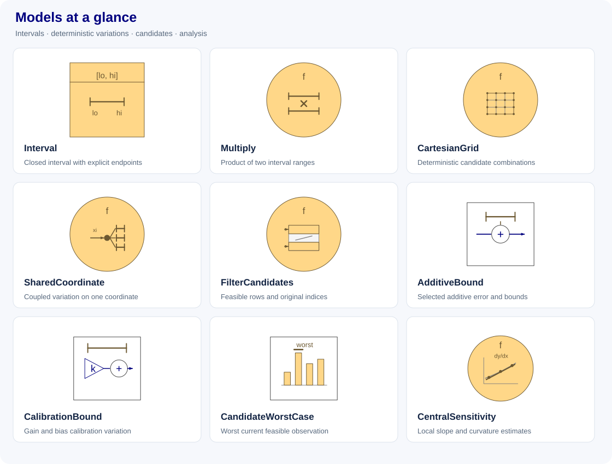

# UncertaintyLibrary

**Deterministic uncertainty calculations for Modelica.**

English · [简体中文](README.zh-CN.md)

UncertaintyLibrary provides closed-interval operations, bounded signal variations, finite candidate construction, constraint checks and response analysis. Functions and signal blocks support explicit modelling of bounds, coupling assumptions and the interpretation of supplied simulation results.

**Version:** 1.0.0 · **Requires:** Modelica Standard Library 4.0.0

## Documentation

- [User Guide](docs/UserGuide.md) — installation, tutorials and complete model reference.
- [中文使用手册](docs/UserGuide.zh-CN.md)

## Licence

[GNU General Public License v3](LICENSE).
