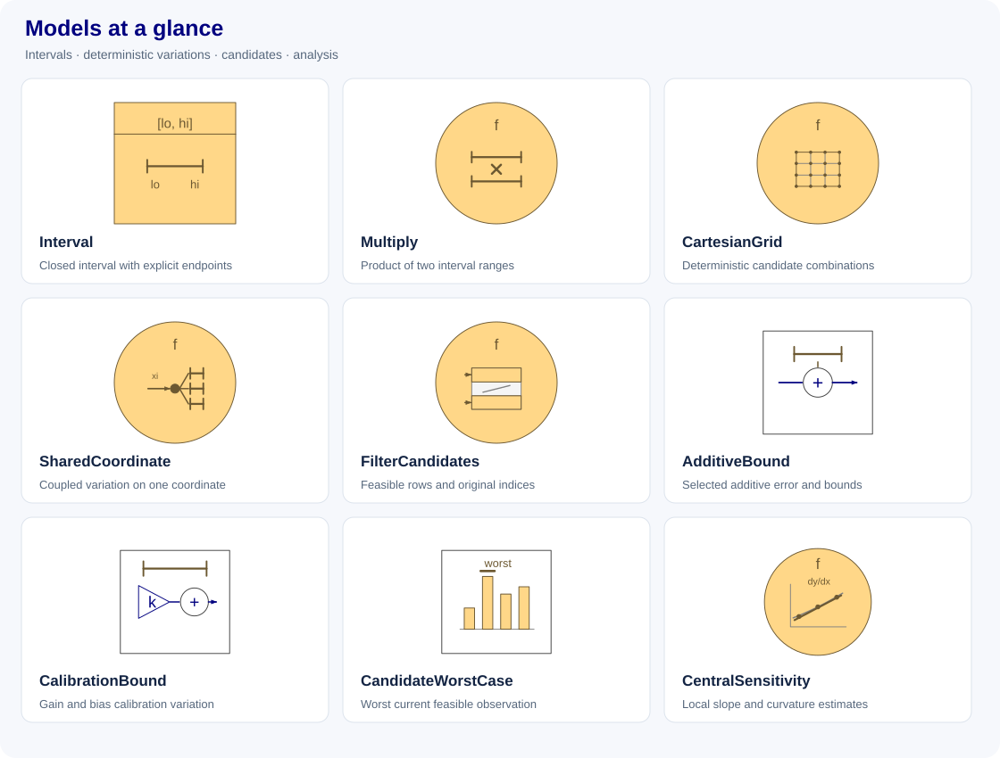

# UncertaintyLibrary

**面向 Modelica 的有界不确定性计算库。**

[English](README.md) · 简体中文

UncertaintyLibrary 提供闭区间运算、有界信号变化、有限候选构造、约束检查与响应分析。通过函数和信号模块明确表达边界及耦合假设，并解释给定的仿真结果。

**版本：** 1.0.0 · **依赖：** Modelica Standard Library 4.0.0

## 文档

- [English User Guide](docs/UserGuide.md) — 默认英文手册。
- [中文使用手册](docs/UserGuide.zh-CN.md) — 安装、教程及完整模型参考。

## 许可证

[GNU General Public License v3](LICENSE)。
