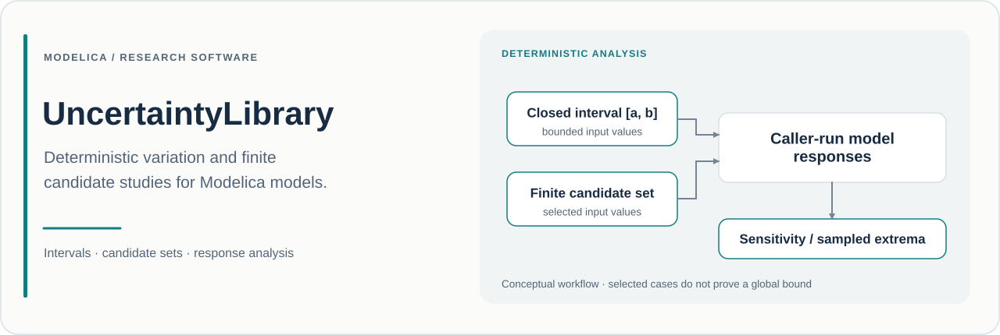

# UncertaintyLibrary

**在 Modelica 中表达确定性不确定性并分析有限候选集。**

[English](README.md) · **简体中文**

[](package.mo)
[](package.mo)

## 项目目的

UncertaintyLibrary 用显式模型表达有界工程假设，包括容差、不确定初始条件、标定误差和选定的模型偏差。它将闭区间、可重复的候选构造、可行性检查、有界信号扰动和给定响应值的分析组织在同一库中。

当研究需要说明**考虑了哪些取值、如何选择这些取值，以及结果证据覆盖什么范围**时，本库提供相应的表达方式。它支持受控比较和局部灵敏度研究，无须预先指定概率分布。候选生成与响应分析相互分离：研究者负责连接或运行本体模型，并将响应提供给分析函数。

| 基本信息 | 当前源码 |
| :--- | :--- |
| Modelica 根包 | `UncertaintyLibrary` |
| 包版本 | **0.2.0**，见 [package.mo](package.mo) |
| 声明的库依赖 | Modelica Standard Library **4.0.0** |
| 示例模型 | [Examples](Examples) 中共 **8 个** |
| 文档核对基线 | [`453dafe`](https://github.com/Ruizhe-Yang/UncertaintyLibrary/commit/453dafe8a87a2382811637ff00b030e6858dc9b6)，2026 年 11 月 12 日 |

## 实现方式

**表达有界量。** [`Sets.Interval`](Sets/Interval.mo) 保存包含端点的上下界。相关函数构造绝对或相对容差，并提供区间运算。[`Sets.SelectPoint`](Sets/SelectPoint.mo) 将 `[-1, 1]` 内的坐标 `xi` 映射到区间：`-1`、`0`、`1` 分别选择下界、中点和上界。物理单位由调用方维护。

**构造并约束明确的候选集。** 一维网格、箱体角点和笛卡尔网格均采用确定性排序。某个维度只有一个点时取中点；笛卡尔积中最后一个维度变化最快。[`Candidates.CartesianGrid`](Candidates/CartesianGrid.mo) 最多允许 **4,096 个点**。[`Constraints.FilterCandidates`](Constraints/FilterCandidates.mo) 使用固定大小的数组返回接受掩码、保留索引、数量与可用标志；只应读取前 `nAccepted` 个索引。[`Candidates.SharedCoordinate`](Candidates/SharedCoordinate.mo) 表达多变量间指定的共同变化方式，并不估计统计相关性。

**施加选定扰动。** 加性误差、增益误差、标定误差及模型偏差模块对输入信号施加有界变化，边界与选择坐标保持为显式输入或参数。这样可以重复指定的候选工况，并直接比较名义和扰动条件。

**分析调用方提供的响应。** Analysis 包计算观测极值、共同采样时刻上的包络、有限差分斜率、归一化灵敏度、有符号裕量和观测序列的单调性。[`Analysis.EnvelopeAtSamples`](Analysis/EnvelopeAtSamples.mo) 要求各条响应的采样网格严格相同，并返回每个采样时刻的有效值数量；它不会自动插值错位轨迹，也不会生成额外仿真。

## 模型组织

| 包 | 职责 | 代表类 |
| :--- | :--- | :--- |
| [Sets](Sets) | 闭区间、容差构造与区间运算 | `Interval`、`RelativeTolerance`、`SelectPoint`、`Divide` |
| [Candidates](Candidates) | 可重复的有限候选构造与选择 | `Grid1D`、`BoxCorners`、`CartesianGrid`、`SharedCoordinate` |
| [Constraints](Constraints) | 箱体边界与线性约束检查 | `BoxFeasibility`、`LinearFeasibility`、`FilterCandidates` |
| [Perturbations](Perturbations) | 选定的有界信号变化 | `AdditiveBound`、`GainBound`、`CalibrationBound` |
| [Analysis](Analysis) | 给定响应的比较与局部分析 | `CandidateExtrema`、`EnvelopeAtSamples`、`FiniteDifference` |
| [Utilities](Utilities) | 有效性函数、类型和示例视图 | `Functions.Valid`、`Views.ExtremaView` |
| [Examples](Examples) | 展示假设与分析过程的连接式示例 | `BoundedMeasurement`、`FiniteCandidateWorstCase` |
| [UsersGuide](UsersGuide) | 建模工具内的信息页面 | `Overview` |

[模型目录](model-catalog.csv) 提供完整类清单。目录中的证据标签应按类理解，不能直接视为整个库对所有工具的兼容性结论。

## 快速开始

```bash
git clone https://github.com/Ruizhe-Yang/UncertaintyLibrary.git
cd UncertaintyLibrary
```

加载 **Modelica 4.0.0**，打开根目录 `package.mo`，选择 `UncertaintyLibrary.Examples.BoundedMeasurement`。该示例声明的仿真范围为 **0–4 s**，输出间隔为 **0.008 s**，容差为 **1e-6**。

在仓库目录中可使用以下 OpenModelica 脚本：

```modelica
loadModel(Modelica, {"4.0.0"});
loadFile("package.mo");
getErrorString();
simulate(UncertaintyLibrary.Examples.BoundedMeasurement,
  startTime=0, stopTime=4, numberOfIntervals=500, tolerance=1e-6);
getErrorString();
```

绘制 `coordinate.y`、`additiveValue` 和 `gainValue`。名义值为 **10**；坐标最初为 **−1**，在 1 s 变为 **0**，在 2 s 变为 **1**。加性误差区间为 **[−0.2, 0.2]**，增益误差区间为 **[−0.02, 0.02]**。因此，在此例中两种定义对应的源码推导值均为 **9.8、10、10.2**。这些是用于复现实验的解析预期值，不是本次新测得的仿真数据。

## 示例索引

| 示例 | 研究内容 | 主要观察变量 | 声明终止时间 |
| :--- | :--- | :--- | ---: |
| [ToleranceAndSelection](Examples/ToleranceAndSelection.mo) | 绝对与相对容差，以及端点和中点选择 | `relativeLo`、`relativeHi`、`absoluteLo`、`mid`、`absoluteHi` | 1 s |
| [IntervalArithmetic](Examples/IntervalArithmetic.mo) | 加减乘除及负系数仿射映射 | `sumLower`、`productUpper`、`ratioLower`、`mappedUpper` | 1 s |
| [CandidateGrids](Examples/CandidateGrids.mo) | 网格规模、排序及单点维度取中点 | `corners`、`gridPoints`、`singleton`、`secondCornerY`、`middleX` | 1 s |
| [CoupledAndConstrainedCandidates](Examples/CoupledAndConstrainedCandidates.mo) | 可行性过滤与共同变化坐标 | `acceptedCount`、`sharedLower`、`sharedMiddle`、`sharedUpper` | 1 s |
| [BoundedMeasurement](Examples/BoundedMeasurement.mo) | 选定的加性与增益误差 | `additiveValue`、`gainValue`、`coordinate.y` | 4 s |
| [InitialConditionEnvelope](Examples/InitialConditionEnvelope.mo) | 不同初态下的三个一阶响应 | `lower`、`upper`、`nValid` | 3 s |
| [FiniteCandidateWorstCase](Examples/FiniteCandidateWorstCase.mo) | 增加内部候选点如何改变观测最大值 | `endpointMaximum`、`enrichedMaximum`、`enrichedIndex` | 1 s |
| [LocalSensitivity](Examples/LocalSensitivity.mo) | 平方响应的中心差分与归一化局部灵敏度 | `slope`、`normalized`、`available` | 1 s |

## 如何解释结果

`FiniteCandidateWorstCase` 名称中的有限候选集具有明确含义。其[实现](Utilities/Views/ExtremaView.mo)对 `1 - p*p` 进行计算：只取端点 `{-1, 1}` 时观测最大值为 **0**，加入中点后为 **1**。这一示例说明仅计算端点可能遗漏内部极值；任何一个有限集结果本身，都不能直接证明任意连续不确定性域中的全局最坏情况。

同样，包络只覆盖提供的轨迹及指定共同网格；观测序列单调不等于全局单调；共同坐标施加指定的依赖结构，但不提供概率规律。明确这些边界，可以使结果更容易被准确引用和复用。

科研使用时，应记录区间端点及单位、候选生成与排序方法、约束、保留行、本体模型版本、求解设置、采样网格和响应有效性。报告观测最大值或最小值时，同时报告候选数量。有限差分分析应说明扰动步长和参考响应，并在解释归一化结果前检查可用标志。

引用软件时，请注明 **UncertaintyLibrary，版本 0.2.0**、仓库地址和实际使用的提交。[更新记录](CHANGELOG.md)与[提交历史](https://github.com/Ruizhe-Yang/UncertaintyLibrary/commits/main/)可用于版本维护。

## 适用范围与假设

当前库面向确定性边界和有限比较，不提供随机抽样、概率估计、自动批量仿真或全局优化保证。区间运算具有明确前提，例如除法要求分母区间不包含零。区间运算中重复使用同一不确定量可能引入依赖性过估计。所选候选集、本体模型假设和响应有效性共同决定结果能够支持的结论范围。

## 许可证与贡献

仓库包含 [GNU 通用公共许可证第 3 版](LICENSE)。提交问题或改进时，请附上源码版本、Modelica 工具及版本、区间或候选定义、预期结果和最小复现示例。边界情形、有效性处理和候选选择示例方面的改进尤其有助于研究复用。
