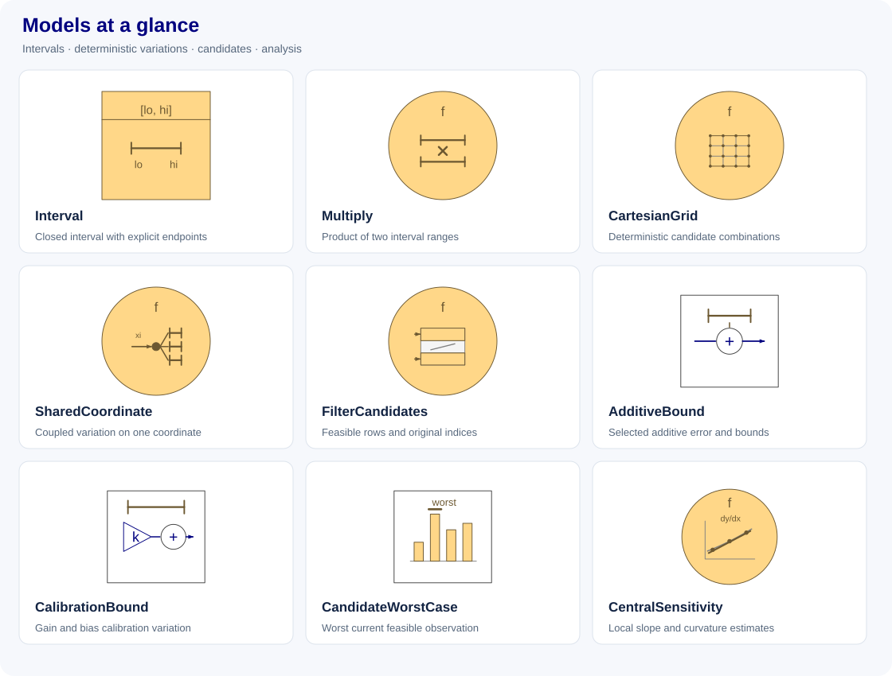

# UncertaintyLibrary v1.0.0 — User Guide

English · [简体中文](UserGuide.zh-CN.md)

## Contents

- [1. Scope and package structure](#1-scope-and-package-structure)
- [2. Load the library and inspect a first example](#2-load-the-library-and-inspect-a-first-example)
- [3. Construct and propagate intervals](#3-construct-and-propagate-intervals)
- [4. Apply selected perturbations and calibration bounds](#4-apply-selected-perturbations-and-calibration-bounds)
- [5. Generate, filter and compare finite candidates](#5-generate-filter-and-compare-finite-candidates)
- [6. Choose local sensitivities, range functions and margins](#6-choose-local-sensitivities-range-functions-and-margins)
- [7. Interpret sampled envelopes and collection status](#7-interpret-sampled-envelopes-and-collection-status)
- [8. Keep assumptions and physical units explicit](#8-keep-assumptions-and-physical-units-explicit)
- [9. Complete model and class reference](#9-complete-model-and-class-reference)
- [10. Included examples](#10-included-examples)
- [11. Troubleshooting and known modelling limits](#11-troubleshooting-and-known-modelling-limits)
- [12. Documentation and further reading](#12-documentation-and-further-reading)

## 1. Scope and package structure

UncertaintyLibrary provides deterministic representations and calculations for bounded variations in Modelica models. Its **57 public definitions** comprise **49 functions, 7 blocks and one interval record**. The library also contains **8 complete examples** and supporting views, functions and types, for a total of **97 Modelica source files**. Its only library dependency is **Modelica Standard Library 4.0.0**.

Use a function when constructing or analysing interval and candidate data. Use a block when applying a selected variation to a signal or collecting current response information. The small `Utilities.Views` blocks expose calculations used by the examples through graphical connectors.

| Package | Definitions | Contents |
| --- | --- | --- |
| [`Sets`](../Sets/package.mo) | 20 | Closed-interval record, arithmetic, tolerances, selection and physical state bounds. |
| [`Perturbations`](../Perturbations/package.mo) | 8 | Selected additive, gain, calibration and model-discrepancy variations. |
| [`Candidates`](../Candidates/package.mo) | 7 | Finite grids, corners, shared coordinates and candidate selection. |
| [`Constraints`](../Constraints/package.mo) | 3 | Box and linear-inequality feasibility with original-row masks. |
| [`Analysis`](../Analysis/package.mo) | 19 | Finite-response comparisons, local sensitivities, formula-based ranges and margins. |

The library uses prescribed bounds, coordinates and candidate sets. These inputs do not define probability distributions. The complete reference in section 9 covers every source file, including the helper and package definitions.



The previews use existing local Modelica `Icon` graphics with instance and parameter labels omitted. The original model icons, diagrams and connector positions are retained.

## 2. Load the library and inspect a first example

1. Extract the archive and retain the complete `UncertaintyLibrary` directory.
2. Load Modelica 4.0.0, then open `UncertaintyLibrary/package.mo`.
3. Open `UncertaintyLibrary.Examples.BoundedMeasurement` and inspect its Diagram view.
4. Use the stored experiment: 0–4 s, output interval 0.008 s and tolerance `1e-6`.
5. Plot `coordinate.y`, `additiveValue`, `gainValue` and the `lower`/`upper` outputs of both perturbation blocks.

The nominal input is 10. Additive error spans [-0.2,0.2] and fractional gain error spans [-0.02,0.02]. The coordinate selects the lower endpoint, midpoint and upper endpoint in sequence.

| Simulation interval | Coordinate | Additive output | Gain output |
| --- | --- | --- | --- |
| 0 ≤ time < 1 s | -1 | 9.8 | 9.8 |
| 1 ≤ time < 2 s | 0 | 10 | 10 |
| 2 ≤ time ≤ 4 s | 1 | 10.2 | 10.2 |

The bounds remain [9.8,10.2]. A selected trajectory is one deterministic choice within the declared uncertainty. Its values are not random draws, and running that trajectory does not enumerate every possible variation.

For OpenModelica, run these commands from the directory containing the library folder:

```modelica
loadModel(Modelica, {"4.0.0"});
loadFile("UncertaintyLibrary/package.mo");
checkModel(UncertaintyLibrary.Examples.BoundedMeasurement);
simulate(UncertaintyLibrary.Examples.BoundedMeasurement,
  startTime=0, stopTime=4, numberOfIntervals=500,
  tolerance=1e-6);
getErrorString();
```

Next, change a range or coordinate in a copy of the example and compare the selected value with its reported bounds. Keep the original example as a connection reference. Numerical values in this guide follow from the supplied equations and parameters.

## 3. Construct and propagate intervals

`Sets.Interval` stores inclusive endpoints `lo` and `hi`; it does not carry a unit or validate itself. Use finite ordered endpoints and keep their units consistent in each calculation. A point interval has equal endpoints.

Save the following complete model as `FirstIntervalCalculation.mo`. It calls interval functions in parameter bindings and exposes their result endpoints for plotting.

```modelica
within;
model FirstIntervalCalculation "Use interval functions in parameter bindings"
  parameter UncertaintyLibrary.Sets.Interval a(lo=-2,hi=3);
  parameter UncertaintyLibrary.Sets.Interval b(lo=4,hi=5);
  parameter UncertaintyLibrary.Sets.Interval productRange=
    UncertaintyLibrary.Sets.Multiply(a,b);
  parameter UncertaintyLibrary.Sets.Interval ratioRange=
    UncertaintyLibrary.Sets.Divide(a,b);
  parameter UncertaintyLibrary.Sets.Interval mappedRange=
    UncertaintyLibrary.Sets.AffineMap(a,-2,1);
  output Real productLower;
  output Real productUpper;
  output Real ratioLower;
  output Real ratioUpper;
  output Real mappedLower;
  output Real mappedUpper;
equation
  productLower=productRange.lo;
  productUpper=productRange.hi;
  ratioLower=ratioRange.lo;
  ratioUpper=ratioRange.hi;
  mappedLower=mappedRange.lo;
  mappedUpper=mappedRange.hi;
  annotation(experiment(StartTime=0, StopTime=1,
    Interval=0.01, Tolerance=1e-6));
end FirstIntervalCalculation;
```

The expected product is [-10,15], quotient [-0.5,0.75] and affine result [-5,5]. A negative affine gain reverses the endpoint mapping; the returned interval is ordered. The divisor [4,5] excludes zero, as required by `Divide`.

| Task | Definition and interpretation |
| --- | --- |
| Symmetric tolerance | `AbsoluteTolerance` uses a radius in the nominal unit; `RelativeTolerance` scales the radius by the nominal magnitude. |
| Different lower/upper allowances | Use the corresponding function in `Sets.Asymmetric`. |
| Arithmetic | `Add`, `Subtract`, `Multiply` and `Divide` return intervals; a denominator touching or crossing zero is rejected. |
| Inclusion and set combination | `Contains`, `Hull` and `Intersection` have different meanings; inspect the `empty` output of `Intersection`. |
| Selected value | `SelectPoint(a,xi)` uses `xi=-1` for `lo`, `xi=0` for the midpoint and `xi=1` for `hi`. |
| Width and midpoint | `Width` and `Midpoint` return scalar summaries, not additional uncertainty models. |

An empty intersection returns [0,0] as a numerical placeholder. That pair can also represent a valid point interval, so the separate `empty` flag is essential.

Interval arithmetic does not retain dependence between repeated occurrences of a quantity. For example, subtracting the same interval [1,2] from itself gives [-1,1], while subtracting one value from that identical value gives zero. Preserve the intended dependency explicitly when a relation depends on shared values. The implementation uses ordinary floating-point operations and does not perform directed outward rounding.

## 4. Apply selected perturbations and calibration bounds

`AdditiveBound` computes a selected additive error. `GainBound` uses a fractional error in the multiplier `1+gainError`. Both can use a fixed signed coordinate `xi` or a connected `coordinate` input when `useCoordinateInput=true`.

The sign of the nominal signal matters for gain variation. This complete example repeats the selection on a nominal value of -10:

```modelica
within;
model FirstSignedPerturbation "Select bounded errors on a negative nominal signal"
  Modelica.Blocks.Sources.Constant nominal(k=-10);
  Modelica.Blocks.Sources.RealExpression coordinate(
    y=if time < 1 then -1 elseif time < 2 then 0 else 1);
  UncertaintyLibrary.Perturbations.AdditiveBound additive(
    useCoordinateInput=true,
    range=UncertaintyLibrary.Sets.Interval(-0.2,0.2));
  UncertaintyLibrary.Perturbations.GainBound gain(
    useCoordinateInput=true,
    range=UncertaintyLibrary.Sets.Interval(-0.02,0.02));
equation
  connect(nominal.y, additive.u);
  connect(nominal.y, gain.u);
  connect(coordinate.y, additive.coordinate);
  connect(coordinate.y, gain.coordinate);
  annotation(experiment(StartTime=0, StopTime=3,
    Interval=0.01, Tolerance=1e-6));
end FirstSignedPerturbation;
```

Plot the selected outputs and their bounds.

| Coordinate | `additive.y` | `gain.y` | Bounds of both outputs |
| --- | --- | --- | --- |
| -1 | -10.2 | -9.8 | [-10.2,-9.8] |
| 0 | -10 | -10 | [-10.2,-9.8] |
| 1 | -9.8 | -10.2 | [-10.2,-9.8] |

Selecting the lower gain error gives the upper output for a negative input. The block sorts the two output endpoints to preserve their order.

Several similarly named parameters use different coordinate conventions:

| Interface | Coordinate convention |
| --- | --- |
| `Sets.SelectPoint` and the additive/gain selection inputs | Signed coordinate [-1,1]; zero is the midpoint. |
| `Candidates.SharedCoordinate` | A common signed coordinate selects coupled departures from nominal values. |
| `Sets.MechanicalStateBox.fractions` | These values are passed directly to `SelectPoint`, so they use [-1,1]. The default 0.5 selects 75% across each interval. |
| `Perturbations.BoundedParameterTrace.fraction` | Coordinate [0,1]; 0.5 is the midpoint. An out-of-range value reports `valid=false` and returns the midpoint. |

`BoundedParameterTrace` supplies a signal; it does not change a Modelica parameter during a simulation. Bind or connect the selected value through an interface appropriate to its variability.

For calibration, distinguish fractional gain error from actual gain. `CalibrationBound` uses `1+gainError`; `InvertCalibration` requires a strictly positive actual gain interval. Sharing a coordinate in `CalibrationBound` couples the selected gain and bias, while its reported lower/upper bounds still cover the full independent box.

`AccuracyEnvelope` calculates its relative allowance from `abs(reading)`. `QuantizationInterval` reconstructs a closed nearest-code bin and does not quantise the reading itself. In `ModelDiscrepancy`, `delta` is a selected coefficient; the additive discrepancy is `basis*delta`. Read these local definitions before combining uncertainty contributions.

## 5. Generate, filter and compare finite candidates

`Grid1D` includes the interval endpoints when more than one point is requested; a one-point grid uses the midpoint. `BoxCorners` enumerates corners, and `CartesianGrid` builds combinations from per-axis counts. The last coordinate changes fastest. The candidate limits keep generated sets finite; check their declared size constraints before choosing a high-dimensional grid.

Use `SharedCoordinate` for a prescribed common variation and `AffineCoordinateMap` for a declared affine relationship. These define deterministic dependence. They do not infer a statistical correlation from observations.

For constraints, `LinearFeasibility(A,b,x,rowTolerance)` evaluates rows of `A*x <= b+rowTolerance`. Each row tolerance has the unit of that row. `FilterCandidates` combines box and linear checks without resizing the candidate matrix.

Save this complete model as `FirstConstrainedCandidates.mo`:

```modelica
within;
model FirstConstrainedCandidates "Filter candidate rows and compare supplied responses"
  parameter UncertaintyLibrary.Sets.Interval box[2]={
    UncertaintyLibrary.Sets.Interval(0,2),
    UncertaintyLibrary.Sets.Interval(0,2)};
  parameter Real candidateSet[9,2]=
    UncertaintyLibrary.Candidates.CartesianGrid(box,{3,3});
  parameter Real responses[9]={
    1-(candidateSet[i,1]-1)^2-(candidateSet[i,2]-1)^2
    for i in 1:9};
  output Boolean acceptedMask[9];
  output Integer acceptedIndices[9];
  output Integer nAccepted;
  output Boolean filterAvailable;
  output Real minimum;
  output Real maximum;
  output Integer iMin;
  output Integer iMax;
  output Boolean extremaAvailable;
equation
  (acceptedMask,acceptedIndices,nAccepted,filterAvailable)=
    UncertaintyLibrary.Constraints.FilterCandidates(
      candidateSet,box,[1.0,1.0],{2.0});
  (minimum,maximum,iMin,iMax,extremaAvailable)=
    UncertaintyLibrary.Analysis.CandidateExtrema(responses,acceptedMask);
  annotation(experiment(StartTime=0, StopTime=1,
    Interval=0.01, Tolerance=1e-6));
end FirstConstrainedCandidates;
```

The inequality is `x1+x2<=2`. The expected results are:

| Result | Value |
| --- | --- |
| `nAccepted` | 6 |
| `acceptedIndices` | {1,2,3,4,5,7,0,0,0} |
| `minimum`, `iMin` | -1, 1 |
| `maximum`, `iMax` | 1, 5 |
| `filterAvailable`, `extremaAvailable` | true, true |

`acceptedMask` retains the original row positions. Only the leading `nAccepted` entries of `acceptedIndices` are accepted original indices; zero entries are padding. Use the mask or those original indices when associating responses with parameter combinations.

`CandidateExtrema` compares the supplied finite, qualified responses and returns the first index in a tie. If none is usable, the numerical results and indices are zero and `available=false`. It does not search the domain between candidates.

The included `FiniteCandidateWorstCase` example makes this limitation explicit: evaluating `1-p*p` at {-1,1} gives an observed maximum of zero; adding p=0 gives one. An observed maximum is tied to the candidate set. The separate `Candidates.FilterCombinations` function has a known call-interface mismatch; use the supported `Constraints.FilterCandidates` path shown above and see section 11.

## 6. Choose local sensitivities, range functions and margins

Sensitivity functions operate on supplied response evaluations. They do not launch new simulations or perturb model parameters automatically.

| Function | Required information and scope |
| --- | --- |
| `FiniteDifference` | Responses at minus and plus perturbations, with `step` equal to the positive half-distance between evaluation points. |
| `CentralSensitivity` | Minus, centre and plus responses with a positive step; returns slope and curvature estimates. |
| `FiniteDifferenceJacobian` | Matched minus/plus response matrices; rows are metrics and columns are perturbed parameters. |
| `NormalizedSensitivity` | Nominal parameter, nominal response and slope; read `available` before interpreting the normalised value. |
| `MonotonicityCheck` | Response values in the intended evaluation order; no coordinate vector is passed. The result classifies only that supplied sequence. |

For `p*p` at p=2 with half-step 0.001, the central slope is 4. With nominal response 4, the normalised value is 2. If the nominal point changes, recompute the corresponding nominal response. `NormalizedSensitivity.available` checks the denominator magnitude; it does not validate all supplied values. A small step is not automatically more accurate: numerical noise and subtraction of nearby values can affect a finite-difference estimate.

Formula-specific range functions have a different scope. `QuadraticRange` checks endpoints and an interior stationary point; `SineRange` checks the trigonometric extrema relevant to its interval. `LipschitzEnvelope` needs derivative bounds valid over the entire supplied box, and `InterpolationErrorBounds` needs a curvature bound valid across the interpolation interval. A local numerical derivative alone does not establish either of those bounds.

Use `SafetyMargin` for the signed distance from supplied observed extrema to a limit. Use `MarginRange` to transform an entire supplied response interval into a margin interval. For an upper limit, the margin is `[limit-response.hi,limit-response.lo]`.

| `MarginRange` status | Meaning for the supplied interval |
| --- | --- |
| `GUARANTEED` | The entire margin interval is nonnegative. |
| `VIOLATED` | The entire margin interval is strictly negative. |
| `UNRESOLVED` | The interval includes both a negative margin and a nonnegative possibility. |

The status classifies the supplied bounds; it does not validate their derivation or add coverage beyond them. In particular, wrapping finite observed extrema in an interval does not establish that all unsampled responses are enclosed.

## 7. Interpret sampled envelopes and collection status

`Analysis.EnvelopeAtSamples` takes a matrix `Y` with runs in rows and sample instants in columns. Supply a strictly increasing finite reference `times` vector, one explicit time-grid row per run and an optional `validMask`. Every grid entry must equal the corresponding reference time exactly. The function does not interpolate misaligned results.

At each sample it uses qualified finite values. A column with no usable values reports lower=0, upper=0 and `nValid=0`; check the count before interpreting the pair as a bound.

The simpler `Utilities.Views.EnvelopeView` used by `InitialConditionEnvelope` has a narrower contract: it samples all three input signals and holds their minimum and maximum. Its `nValid` is always 3 and does not check qualification or finiteness.

In `InitialConditionEnvelope`, the three first-order responses start at -0.1, 0 and 0.1 with a 0.5 s time constant and zero input. At sample instants, the extrema are `±0.1*exp(-time/0.5)`. Plot `run1.y`, `run2.y`, `run3.y`, `lower` and `upper` to inspect the held envelope. Those outputs describe the sampled responses; intersample behaviour and other initial conditions require their own analysis.

`CandidateWorstCase` combines current metric values with separate `feasible`, `valid` and `collectionComplete` inputs. It returns the original row index of the selected candidate and reports how many candidates are feasible and observed; it does not accumulate extrema over time.

| Evidence state | Interpretation |
| --- | --- |
| `NOT_APPLICABLE` | No supplied candidate is feasible. |
| `INVALID` | A feasible candidate marked valid has a non-finite metric. |
| `UNDECIDED` | At least one candidate is feasible and no marked-valid feasible metric is invalid, but collection is incomplete or a feasible observation is missing. |
| `COMPLETE` | At least one candidate is feasible, collection is declared complete and every feasible candidate has a valid finite observation. |

`COMPLETE` refers to this declared finite collection. It does not establish a continuous-domain worst case. Read `selectedIndex` before using `worstObserved`; zero means no usable selection.

## 8. Keep assumptions and physical units explicit

Begin with the quantity to vary, its unit, its nominal value and the source of its bounds. Decide whether uncertain quantities vary independently or share a declared coordinate or constraint. Preserve that choice when constructing candidates and interpreting the resulting intervals.

The physical range helpers cover specific relations, including mechanical state, stored electrical or thermal energy, gas inventory, hydrostatic pressure, radiative exchange and wind pressure. Supply parameters in the units and sign ranges documented by each helper. These calculations do not add the corresponding physical storage or boundary components to a simulation.

Keep four items together when comparing runs: the candidate row or coordinate, the actual parameter or initial-state binding, the response values and their validity. Align time grids before applying sampled-envelope calculations. Record the evaluation step and nominal response when reporting a sensitivity.

Use the same explicit configuration when comparing model alternatives. A broader interval, a denser grid and a different coupling assumption change the question being evaluated. The complete reference below identifies the configuration and important limits for every definition.

## 9. Complete model and class reference

The tables cover all 97 source files, grouped by package. Each link opens the corresponding Modelica definition. Read the configuration and limits when choosing an interval operation, perturbation, candidate method or response calculation.

### 9.1. UncertaintyLibrary

| Class | Purpose | Configuration and limits |
| --- | --- | --- |
| [`UncertaintyLibrary`](../package.mo) | Closed intervals, deterministic candidates and bounded variations | Load package.mo with Modelica 4.0.0 and begin with Examples.BoundedMeasurement. |

### 9.2. Sets

| Class | Purpose | Configuration and limits |
| --- | --- | --- |
| [`Sets`](../Sets/package.mo) | Closed intervals, tolerance ranges and deterministic selections | Choose a constructor or operation and retain its unit, validity and dependence assumptions. |
| [`AbsoluteTolerance`](../Sets/AbsoluteTolerance.mo) | Symmetric interval from an absolute tolerance | Pass center and a nonnegative tol in the same physical unit. |
| [`Add`](../Sets/Add.mo) | Sum of two closed intervals | Call Add(a,b) with finite ordered intervals in compatible units. All combinations of the two intervals are admitted; shared-variable dependence is not retained. |
| [`AffineMap`](../Sets/AffineMap.mo) | Affine image with endpoint reordering | Set scale and offset with units compatible with the intended affine relation. |
| [`Contains`](../Sets/Contains.mo) | Membership test including both interval endpoints | Call Contains(a,value) to test inclusive membership. |
| [`Divide`](../Sets/Divide.mo) | Interval quotient with a denominator excluding zero | Pass finite ordered intervals and ensure b.lo&gt;0 or b.hi&lt;0. Touching zero at either denominator endpoint is rejected. |
| [`GasInventoryBounds`](../Sets/GasInventoryBounds.mo) | Ideal-gas mass bounds from pressure, volume and temperature | Supply positive absolute pressure, volume and temperature intervals with a compatible specificGasConstant. Uses the ideal-gas relation over the full input box; correlations and non-ideal gas effects are not represented. |
| [`Hull`](../Sets/Hull.mo) | Smallest closed interval containing two intervals | Call Hull(a,b) with compatible interval units. A gap between the inputs becomes part of the hull. |
| [`Intersection`](../Sets/Intersection.mo) | Closed-interval intersection with an explicit empty flag | Use both bounds and empty; accept bounds only when empty=false. The [0,0] placeholder for an empty result is indistinguishable from a valid singleton without the flag. |
| [`Interval`](../Sets/Interval.mo) | Closed interval endpoints with application-defined units | Construct Interval(lo,hi), keep both endpoints in the same unit and check Valid where needed. The constructor does not validate the endpoints; an empty intersection is reported separately. |
| [`MechanicalStateBox`](../Sets/MechanicalStateBox.mo) | Selected position and velocity from independent state intervals | Pass positionRange, speedRange and two signed coordinates; bind the returned position and velocity to state starts. fractions uses [-1,1]; its default 0.5 selects the 75% point, not the midpoint. No kinematic constraint is imposed. |
| [`Midpoint`](../Sets/Midpoint.mo) | Weighted midpoint of a closed interval | Call Midpoint(a) for the central deterministic value. |
| [`Multiply`](../Sets/Multiply.mo) | Product range from all four endpoint combinations | Call Multiply(a,b) and interpret the result in the product of the input units. Multiply(a,a) treats the two occurrences independently and need not give the range of a squared quantity. |
| [`RelativeTolerance`](../Sets/RelativeTolerance.mo) | Symmetric interval scaled by the nominal magnitude | Pass the signed center and a nonnegative relative fraction. Relative tolerance alone gives zero width when center=0. |
| [`SelectPoint`](../Sets/SelectPoint.mo) | Deterministic interval point from a signed coordinate | Use xi=-1 for the lower endpoint, 0 for the midpoint and 1 for the upper endpoint. The coordinate convention is [-1,1], not [0,1]. |
| [`StoredElectricalEnergy`](../Sets/StoredElectricalEnergy.mo) | Combined capacitive and inductive energy bounds | Pass capacitance, signed voltage, inductance and signed current intervals; read energy in joules. Capacitance and inductance must be nonnegative; coupling among the input quantities is not retained. |
| [`Subtract`](../Sets/Subtract.mo) | Difference of two closed intervals | Call Subtract(a,b) with finite ordered intervals in compatible units. Subtracting the same non-singleton interval from itself generally gives a nonzero-width result. |
| [`ThermalInitialEnergy`](../Sets/ThermalInitialEnergy.mo) | Thermal energy bounds relative to a reference temperature | Pass capacity and initial-temperature intervals with a fixed referenceTemperature. Energy is relative to the chosen reference and is not constrained to be nonnegative. |
| [`Width`](../Sets/Width.mo) | Difference between upper and lower endpoints | Call Width(a); interpret the result in the interval unit. |

### 9.3. Sets.Asymmetric

| Class | Purpose | Configuration and limits |
| --- | --- | --- |
| [`Asymmetric`](../Sets/Asymmetric/package.mo) | Separate lower and upper tolerance allowances | Choose absolute allowances or relative fractions for the two sides of a signed nominal value. |
| [`AbsoluteTolerance`](../Sets/Asymmetric/AbsoluteTolerance.mo) | Interval from separate lower and upper absolute tolerances | Set nominal and the two nonnegative absolute allowances. |
| [`RelativeTolerance`](../Sets/Asymmetric/RelativeTolerance.mo) | Interval from separate fractions of the nominal magnitude | Set the signed nominal value and separate nonnegative lowerFraction and upperFraction. The allowances are fractions of abs(nominal), not signed percentage shifts. |

### 9.4. Perturbations

| Class | Purpose | Configuration and limits |
| --- | --- | --- |
| [`Perturbations`](../Perturbations/package.mo) | Deterministic signal perturbations and measurement intervals | Choose the error relation, coordinate convention and required bound or validity outputs. |
| [`AccuracyEnvelope`](../Perturbations/AccuracyEnvelope.mo) | Measurement interval from absolute and reading-relative allowances | Pass reading, an absolute allowance in its unit and a dimensionless relativeError fraction. The relative term is based on abs(reading), not on the unknown physical value. |
| [`AdditiveBound`](../Perturbations/AdditiveBound.mo) | Selected additive error with pointwise output bounds | Set range, select xi or enable coordinate, and connect u; inspect y, delta, lower and upper. The output bounds are pointwise shifts of the supplied input, not an envelope of the receiving system response. |
| [`BoundedParameterTrace`](../Perturbations/BoundedParameterTrace.mo) | Bounded signal driven by a deterministic unit coordinate | Set bounds and connect fraction in [0,1]; read valid alongside value. Uses [0,1], unlike SelectPoint; an out-of-range coordinate returns the midpoint with valid=false. |
| [`CalibrationBound`](../Perturbations/CalibrationBound.mo) | Selected relative gain and bias errors with box bounds | Set gainRange and biasRange, choose xi or coordinate, then use xiBias or shareCoordinate for the bias selection. Sharing the selected coordinate does not tighten lower and upper to the correlated range. |
| [`GainBound`](../Perturbations/GainBound.mo) | Selected relative gain error with signed output bounds | Set the relative-error range, choose the signed coordinate and connect u; read gainError and the output bounds. The actual multiplier is 1+gainError; range is not an interval of absolute gains. |
| [`InvertCalibration`](../Perturbations/InvertCalibration.mo) | Calibration inverse with strictly positive gain bounds | Pass reading, a strictly positive actual gain interval and an offset interval in the reading unit. Requires actual gain, not gain error; dependence between reading, gain and offset is not retained. |
| [`ModelDiscrepancy`](../Perturbations/ModelDiscrepancy.mo) | Selected discrepancy coefficient applied to an explicit basis | Connect u and basis, set the coefficient range and choose a fixed or externally driven signed coordinate. delta is the selected coefficient; the actual additive discrepancy is basis*delta. |
| [`QuantizationInterval`](../Perturbations/QuantizationInterval.mo) | Closed measurement bin for rounding to the nearest code | Pass the rounded reading and positive resolution in the same unit. Assumes rounding to the nearest code; truncation and saturation need different intervals. |

### 9.5. Candidates

| Class | Purpose | Configuration and limits |
| --- | --- | --- |
| [`Candidates`](../Candidates/package.mo) | Deterministic grids, shared coordinates and row selection | Construct the candidate matrix, retain its row order and apply supported feasibility operations before response aggregation. |
| [`AffineCoordinateMap`](../Candidates/AffineCoordinateMap.mo) | Affine mapping of shared coordinates to coupled parameters | Set origin and the signed directions matrix, then call AffineCoordinateMap for each chosen shared-coordinate vector. The caller supplies finite map coefficients and the intended coupling; no feasibility or probabilistic model is inferred. |
| [`BoxCorners`](../Candidates/BoxCorners.mo) | Box-corner enumeration with the final axis changing fastest | Call BoxCorners(box) for one to ten coordinate intervals; keep row order when associating responses with candidates. Corner enumeration does not exclude interior extrema, and zero-width axes retain duplicate corners. |
| [`CartesianGrid`](../Candidates/CartesianGrid.mo) | Deterministic Cartesian grid with a bounded total size | Call CartesianGrid(box, counts) with positive per-axis counts and a total of at most 4096 rows. A singleton axis uses its midpoint; increasing grid density still produces only a finite candidate set. |
| [`FilterCombinations`](../Candidates/FilterCombinations.mo) | Box and coupled-constraint filtering wrapper | Review the internal LinearFeasibility call before use; combine supported box and linear feasibility masks explicitly for the intended filter. The supplied five-argument, three-result call is incompatible with the current four-input, two-output LinearFeasibility signature. |
| [`Grid1D`](../Candidates/Grid1D.mo) | Uniform closed-interval grid with a midpoint singleton | Call Grid1D(a, n) with a valid interval and n at least one; use the returned values as explicit parameter choices. A one-point grid is the midpoint and does not sample either endpoint unless the interval has zero width. |
| [`SelectCandidate`](../Candidates/SelectCandidate.mo) | Selection of an existing one-based candidate row | Call SelectCandidate(candidates, index) with an existing row index and retain candidateId with the resulting response. Only the row-index range is checked; selection does not establish candidate feasibility. |
| [`SharedCoordinate`](../Candidates/SharedCoordinate.mo) | Common or per-parameter deterministic coordinate selection | Provide centre and nonnegative scale vectors; choose shared xi or set shared=false with explicit coordinates. Shared scaling has one common orientation; finite values and the intended deterministic coupling remain caller assumptions. |

### 9.6. Constraints

| Class | Purpose | Configuration and limits |
| --- | --- | --- |
| [`Constraints`](../Constraints/package.mo) | Closed-box and linear candidate feasibility | Use BoxFeasibility or LinearFeasibility for one point and FilterCandidates for a finite matrix. |
| [`BoxFeasibility`](../Constraints/BoxFeasibility.mo) | Closed-box membership with per-coordinate results | Supply one interval per coordinate and read feasible together with the per-coordinate mask. Interval validity is asserted; the function does not repair an unordered box. |
| [`FilterCandidates`](../Constraints/FilterCandidates.mo) | Candidate feasibility mask and retained original row indices | Read acceptedMask, acceptedIndices, nAccepted and available; use only the leading nAccepted indices to select original rows. No accepted row means none of the supplied finite candidates passed; it does not establish infeasibility of the continuous domain. |
| [`LinearFeasibility`](../Constraints/LinearFeasibility.mo) | Row-wise feasibility of linear upper inequalities | Provide A, b and one point x; set nonnegative rowTolerance in each inequality row's unit. Returns feasibility and a row mask, not violation magnitudes or lower-bound constraints. |

### 9.7. Analysis

| Class | Purpose | Configuration and limits |
| --- | --- | --- |
| [`Analysis`](../Analysis/package.mo) | Response ranges, observed extrema and local sensitivity | Choose an observed-data operation or a structure-based range relation and retain its stated validity and coverage assumptions. |
| [`AffineDiscrepancy`](../Analysis/AffineDiscrepancy.mo) | Scaled prediction with an additive discrepancy interval | Call AffineDiscrepancy(prediction, scale, bias) with scale dimensionless and bias in the prediction unit. The result represents the rectangular scale-and-bias domain; dependencies between them are not retained. |
| [`CandidateExtrema`](../Analysis/CandidateExtrema.mo) | Finite-candidate extrema and their first row indices | Call CandidateExtrema(responses, valid) and read available before using the extrema or one-based indices. An unavailable result uses zero placeholders; an observed extremum does not establish a continuous-domain bound. |
| [`CandidateWorstCase`](../Analysis/CandidateWorstCase.mo) | Worst current finite-candidate response with collection status | Connect metrics, feasible and valid for the same n rows; set largerIsWorse and supply collectionComplete independently. The result is not a time maximum or a continuous-domain guarantee; COMPLETE concerns only the declared feasible rows. |
| [`CentralSensitivity`](../Analysis/CentralSensitivity.mo) | Central slope and curvature from three matched responses | Supply matched responses at parameter values p-step, p and p+step; interpret slope and curvature in the corresponding units. Finite-difference estimates are local and depend on step size; they are not global derivative bounds. |
| [`EnvelopeAtSamples`](../Analysis/EnvelopeAtSamples.mo) | Observation envelope on exactly matched sample grids | Call EnvelopeAtSamples(Y, times, grids, validMask) with rows as candidates and columns as identical sample times. Read nValid with the endpoints; grid equality is exact and no continuous-time envelope is inferred. |
| [`FiniteDifference`](../Analysis/FiniteDifference.mo) | Central finite difference from two supplied responses | Call FiniteDifference(fMinus, fPlus, step) for matched responses at p-step and p+step. The caller must supply finite values and a suitable finite step; positivity is the only internal check. |
| [`FiniteDifferenceJacobian`](../Analysis/FiniteDifferenceJacobian.mo) | Central response Jacobian from matched perturbation matrices | Arrange metrics by row and parameters by column, then call FiniteDifferenceJacobian(minusValues, plusValues, steps). Each column assumes a matched one-parameter perturbation; the returned matrix does not establish global sensitivity bounds. |
| [`HydrostaticPressureBounds`](../Analysis/HydrostaticPressureBounds.mo) | Hydrostatic pressure from surface, density and depth intervals | Call HydrostaticPressureBounds(surfacePressure, density, depth, gravity) with compatible SI quantities and downward-positive depth. Assumes a hydrostatic relation with constant gravity and a single density range over the depth. |
| [`InterpolationErrorBounds`](../Analysis/InterpolationErrorBounds.mo) | Linear-interpolation error from a supplied curvature bound | Supply the linear interpolation estimate, node spacing, fractional coordinate and a valid whole-interval absolute curvature bound. The enclosure is conditional on the supplied interpolant and curvature bound being valid over the whole interval. |
| [`LipschitzEnvelope`](../Analysis/LipschitzEnvelope.mo) | Coordinatewise derivative envelope about a nominal point | Provide the nominal response and point, coordinate ranges and whole-box derivative bounds in output-unit per input-unit. The function neither derives nor verifies the derivative bounds; coverage depends on their validity throughout the box. |
| [`MarginRange`](../Analysis/MarginRange.mo) | Signed margin interval and its supplied-bound classification | Call MarginRange(response, limit, upperLimit) using one unit for response and limit; read both margin and status. GUARANTEED is conditional on the supplied response interval; it is not an independent validation of that interval. |
| [`MonotonicityCheck`](../Analysis/MonotonicityCheck.mo) | Classification of the supplied sample order | Call MonotonicityCheck(samples) with finite observations already ordered by the independent coordinate. Observed sequence order does not establish continuous-domain monotonicity, and the function does not sort or validate finiteness. |
| [`NormalizedSensitivity`](../Analysis/NormalizedSensitivity.mo) | Normalised local slope with a response-magnitude guard | Call NormalizedSensitivity(parameterNominal, responseNominal, slope, floorMagnitude) and inspect available with value. A zero unavailable result is a placeholder; availability tests only nominal response magnitude. |
| [`QuadraticRange`](../Analysis/QuadraticRange.mo) | Quadratic range including an interior vertex | Call QuadraticRange(x, a, b, c) for a fixed-coefficient quadratic over interval x. The coefficients are fixed Real inputs; uncertainty in them is not propagated as separate ranges. |
| [`RadiativeExchangeBounds`](../Analysis/RadiativeExchangeBounds.mo) | Net radiative heat-flow interval between two temperature bands | Supply positive absolute-temperature intervals and a nonnegative effective radiating area, then read the signed heat-flow interval. The supplied effective area must already include the intended radiative exchange factors. |
| [`SafetyMargin`](../Analysis/SafetyMargin.mo) | Signed requirement margin from observed extrema | Call SafetyMargin(worstMin, worstMax, limit, sense) after confirming that usable extrema are available. Only extremum ordering is asserted; finiteness and domain coverage remain caller responsibilities. |
| [`SineRange`](../Analysis/SineRange.mo) | Sine range including enclosed peaks and troughs | Call SineRange(angle) with a radian interval to include endpoint and interior trigonometric extrema. Endpoint magnitudes are restricted to 1e8 radians; the calculation does not use directed rounding. |
| [`TemperatureBand`](../Analysis/TemperatureBand.mo) | Deterministic temperature-offset band with validity output | Connect nominal, set a finite ordered offset interval and inspect valid together with lower and upper. Invalid outputs use zero placeholders rather than a physical temperature interval. |
| [`WindPressureBounds`](../Analysis/WindPressureBounds.mo) | Dynamic-pressure interval from signed speed and density | Call WindPressureBounds(speed, density) with signed speed and a nonnegative density interval. Dynamic pressure is unsigned; aerodynamic coefficients and loads must be modelled separately. |

### 9.8. Utilities

| Class | Purpose | Configuration and limits |
| --- | --- | --- |
| [`Utilities`](../Utilities/package.mo) | Supporting predicates, types and graphical views | Use the helper contract or view appropriate to the required calculation and inspect its limits. |

### 9.9. Utilities.Functions

| Class | Purpose | Configuration and limits |
| --- | --- | --- |
| [`Functions`](../Utilities/Functions/package.mo) | Interval validation and bounded grid sizing | Use Valid for endpoint checks and GridSize for the bounded Cartesian point count. |
| [`GridSize`](../Utilities/Functions/GridSize.mo) | Cartesian product cardinality capped at 4096 points | Call GridSize(counts) before allocating a Cartesian grid; treat zero as an invalid or excessive size. The 4096-point limit applies to the product, not independently to each axis. |
| [`Valid`](../Utilities/Functions/Valid.mo) | Check finite ordered interval endpoints | Call Valid(x) before using an interval when a Boolean validity result is required. |

### 9.10. Utilities.Internal

| Class | Purpose | Configuration and limits |
| --- | --- | --- |
| [`Internal`](../Utilities/Internal/package.mo) | Internal interval-validity support | Consult validInterval when reviewing the calling interval calculation. |
| [`validInterval`](../Utilities/Internal/validInterval.mo) | Internal check for finite ordered interval endpoints | Use as the Boolean endpoint predicate required by the calling implementation. |

### 9.11. Utilities.Types

| Class | Purpose | Configuration and limits |
| --- | --- | --- |
| [`Types`](../Utilities/Types/package.mo) | Bound orientation and deterministic result labels | Use the exact enumeration type declared by the receiving function or block. |
| [`EvidenceState`](../Utilities/Types/EvidenceState.mo) | Evidence state of the supplied finite candidate set | Read EvidenceState with feasibleCount, observedCount and collectionComplete in CandidateWorstCase. |
| [`MarginStatus`](../Utilities/Types/MarginStatus.mo) | Classification of a supplied signed-margin interval | Read MarginStatus together with the returned margin interval and the assumptions behind the response bounds. |
| [`SampleOrder`](../Utilities/Types/SampleOrder.mo) | Observed order of an explicit sample sequence | Use SampleOrder to interpret the result of MonotonicityCheck on the supplied sequence. |
| [`Sense`](../Utilities/Types/Sense.mo) | Orientation of an admissible response bound | Select Upper or Lower when calling a function whose interface declares Sense. |

### 9.12. Utilities.Views

| Class | Purpose | Configuration and limits |
| --- | --- | --- |
| [`Views`](../Utilities/Views/package.mo) | Signal views of selected uncertainty calculations | Use a view to inspect its stated example calculation; call the underlying functions for a different data shape. |
| [`ArithmeticView`](../Utilities/Views/ArithmeticView.mo) | Display endpoint results of fixed interval operations | Set a and b, then plot the paired lower and upper outputs; retain consistent derived parameter bindings. |
| [`CandidateView`](../Utilities/Views/CandidateView.mo) | Display finite-grid size and coordinate ordering | Use the outputs to inspect the default two-dimensional candidate order; use the candidate functions directly for other grid sizes. |
| [`ConstraintView`](../Utilities/Views/ConstraintView.mo) | Display finite candidate feasibility and a shared coordinate | Inspect acceptedCount with mask and indices; compare sharedLower, sharedMiddle and sharedUpper independently. The accepted count applies only to the supplied nine-point grid. |
| [`EnvelopeView`](../Utilities/Views/EnvelopeView.mo) | Sample and hold extrema of three simultaneous inputs | Connect three finite response signals and choose samplePeriod; plot held lower and upper values. nValid is always three and is not a validated observation count; intersample extrema are not captured. |
| [`ExtremaView`](../Utilities/Views/ExtremaView.mo) | Compare observed maxima on two finite point sets | Compare endpointMaximum and enrichedMaximum, and use enrichedIndex to locate the selected enriched point. |
| [`IntervalView`](../Utilities/Views/IntervalView.mo) | Display tolerance intervals and deterministic point selections | Set relativeRange and absoluteRange, then inspect their endpoint and midpoint outputs. |
| [`SensitivityView`](../Utilities/Views/SensitivityView.mo) | Display central slope and normalised local sensitivity | Set center, a positive step and the consistent responseNominal; inspect slope, normalized and available. A local finite-difference result is not a bound over the full parameter interval. |

### 9.13. UsersGuide

| Class | Purpose | Configuration and limits |
| --- | --- | --- |
| [`UsersGuide`](../UsersGuide/package.mo) | User's guide | Read GettingStarted, Conventions and Limitations before adapting the examples. |
| [`Conventions`](../UsersGuide/Conventions.mo) | Units, selection coordinates and availability flags | Check units, coordinate convention, result flags and candidate identity before combining calculations. |
| [`GettingStarted`](../UsersGuide/GettingStarted.mo) | Load the library and inspect selected bounded errors | Run BoundedMeasurement and compare each selected value with its bounds, then inspect candidate coverage. |
| [`Limitations`](../UsersGuide/Limitations.mo) | Numerical assumptions, coverage and known interface limits | Review dependency assumptions, finite coverage, floating-point behaviour and the FilterCombinations call mismatch. |
| [`Overview`](../UsersGuide/Overview.mo) | Deterministic uncertainty representations and calculations | Choose the package by the interval, perturbation, candidate or response-analysis interface required. |

### 9.14. Examples

| Class | Purpose | Configuration and limits |
| --- | --- | --- |
| [`Examples`](../Examples/package.mo) | Complete examples of deterministic uncertainty calculations | Run BoundedMeasurement first, then select the interval, candidate, sensitivity or envelope example. |
| [`BoundedMeasurement`](../Examples/BoundedMeasurement.mo) | Select additive and gain errors with a common coordinate | Run the stored experiment; see section 10. |
| [`CandidateGrids`](../Examples/CandidateGrids.mo) | Inspect finite grids and their candidate ordering | Run the stored experiment; see section 10. |
| [`CoupledAndConstrainedCandidates`](../Examples/CoupledAndConstrainedCandidates.mo) | Filter a finite grid and compare shared-coordinate selections | Run the stored experiment; see section 10. |
| [`FiniteCandidateWorstCase`](../Examples/FiniteCandidateWorstCase.mo) | Compare sampled maxima before and after adding a midpoint | Run the stored experiment; see section 10. |
| [`InitialConditionEnvelope`](../Examples/InitialConditionEnvelope.mo) | Sample the envelope of three initial-state responses | Run the stored experiment; see section 10. |
| [`IntervalArithmetic`](../Examples/IntervalArithmetic.mo) | Compare interval arithmetic and signed affine mapping | Run the stored experiment; see section 10. |
| [`LocalSensitivity`](../Examples/LocalSensitivity.mo) | Evaluate central and normalised sensitivity of a squared response | Run the stored experiment; see section 10. |
| [`ToleranceAndSelection`](../Examples/ToleranceAndSelection.mo) | Construct tolerance intervals and select their endpoints | Run the stored experiment; see section 10. |

## 10. Included examples

Each example is self-contained and includes stored experiment settings. All use tolerance `1e-6`; their simulation and output intervals are listed below. Begin with the listed outputs.

| Example | Simulation interval; output interval | What to inspect |
| --- | --- | --- |
| [`BoundedMeasurement`](../Examples/BoundedMeasurement.mo) | 0–4 s; 0.008 s | Plot additiveValue and gainValue with the coordinate and bounds; the selected levels are 9.8, 10 and 10.2. |
| [`CandidateGrids`](../Examples/CandidateGrids.mo) | 0–1 s; 0.002 s | Inspect corners=4, gridPoints=9, singleton=1, secondCornerY=1 and middleX=1, then examine the candidate arrays. |
| [`CoupledAndConstrainedCandidates`](../Examples/CoupledAndConstrainedCandidates.mo) | 0–1 s; 0.002 s | Check acceptedCount=6 and the displayed shared-coordinate values 4.7, 5 and 5.3. |
| [`FiniteCandidateWorstCase`](../Examples/FiniteCandidateWorstCase.mo) | 0–1 s; 0.002 s | Compare endpointMaximum=0 with enrichedMaximum=1 and enrichedIndex=2. |
| [`InitialConditionEnvelope`](../Examples/InitialConditionEnvelope.mo) | 0–3 s; 0.006 s | Plot the three run outputs with lower and upper; check the sample-and-hold behaviour and fixed nValid=3. |
| [`IntervalArithmetic`](../Examples/IntervalArithmetic.mo) | 0–1 s; 0.002 s | Compare the sum, difference, product, ratio and mapped endpoint pairs with the stated intervals. |
| [`LocalSensitivity`](../Examples/LocalSensitivity.mo) | 0–1 s; 0.002 s | Check slope=4, normalized=2 and available=true; keep the nominal response consistent when changing the centre. |
| [`ToleranceAndSelection`](../Examples/ToleranceAndSelection.mo) | 0–1 s; 0.002 s | Check relative bounds [-11,-9] and absolute selections 1.9, 2 and 2.1. |

## 11. Troubleshooting and known modelling limits

| Observation | Check |
| --- | --- |
| Interval division is rejected | The denominator interval must exclude zero, including at its endpoints. |
| [0,0] appears after an intersection | Check `empty`; the returned endpoints alone do not distinguish an empty result from a point interval. |
| Coordinate 0.5 does not select the midpoint | Check the convention: signed [-1,1] selection differs from a [0,1] fraction. |
| Gain output moves in the opposite direction to the coordinate | A negative nominal input reverses the gain-error-to-output mapping. |
| A parameter trace does not alter a model parameter | The trace is a signal; bind or connect it through an appropriate model interface. |
| Filtered indices include zero | Only the leading `nAccepted` entries contain accepted original row numbers. |
| Sampled-envelope inputs are rejected | Shapes must match and the explicit grid rows must equal the reference grid exactly. |
| A normalised sensitivity is zero | Inspect `available`; a small nominal-response magnitude returns an unavailable placeholder. |
| A finite candidate comparison reports complete | Completion covers the declared collection and does not certify unsampled points. |

### Known interface limitation: FilterCombinations

`Candidates.FilterCombinations` calls `Constraints.LinearFeasibility` with five arguments and assigns three outputs. The defined function accepts `(A,b,x,rowTolerance)` and returns only `(feasible,mask)`; the wrapper also passes arguments with incompatible ranks and meanings.

This is a source-level call-contract mismatch. The existing wrapper is not a verified implementation of the intended filter. For the supported box-and-linear-inequality workflow, use `Constraints.FilterCandidates(candidates,box,A,b,rowTolerance)` as shown in section 5. The original wrapper's computational code is retained in this release, and the limitation is stated in its model documentation.

### Numerical and coverage limits

The calculations use ordinary floating-point arithmetic without directed outward rounding. Interval dependency, invalid input, near-zero divisors, finite-difference step size and numerical overflow can affect interpretation. Read result flags and the preconditions of the selected operation.

Finite grids do not prove continuous coverage, and sampled monotonicity does not prove monotonicity between samples. A formula-based or derivative-based enclosure relies on its stated assumptions. An evidence or margin status does not independently validate those assumptions. Analytical values in this guide follow from the supplied equations; compare them with results in the Modelica environment used for the application.

## 12. Documentation and further reading

- [English project overview](../README.md) / [中文项目说明](../README.zh-CN.md)
- [In-tool User's Guide](../UsersGuide/package.mo)
- [Root package](../package.mo)
- [Buildings Library User Guide — Getting Started](https://simulationresearch.lbl.gov/modelica/userGuide/gettingStarted.html)
- [Buildings — SimpleHouse step-by-step tutorial](https://simulationresearch.lbl.gov/modelica/releases/v11.1.2/help/Buildings_Examples_Tutorial_SimpleHouse.html)
- [Modelica documentation conventions](https://doc.modelica.org/Modelica%204.0.0/Resources/helpDymola/Modelica_UsersGuide_Conventions_Documentation.html)
- [Licence: GNU General Public License v3](../LICENSE)
