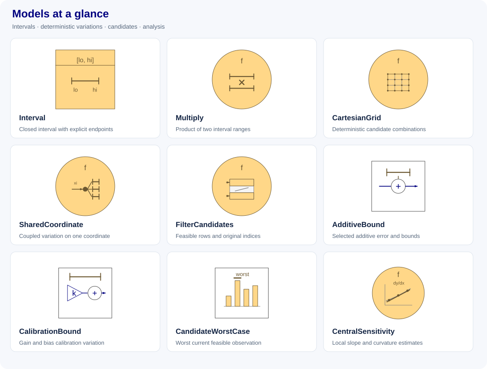

# UncertaintyLibrary v1.0.0 — 使用手册

[English](UserGuide.md) · 简体中文

## 目录

- [1. 用途与包结构](#1-用途与包结构)
- [2. 加载库并查看首个示例](#2-加载库并查看首个示例)
- [3. 构造与传播区间](#3-构造与传播区间)
- [4. 施加选定扰动与校准边界](#4-施加选定扰动与校准边界)
- [5. 生成、筛选与比较有限候选](#5-生成筛选与比较有限候选)
- [6. 选择局部灵敏度、范围函数与裕量](#6-选择局部灵敏度范围函数与裕量)
- [7. 解释采样包络与采集状态](#7-解释采样包络与采集状态)
- [8. 明确假设与物理单位](#8-明确假设与物理单位)
- [9. 完整模型与类参考](#9-完整模型与类参考)
- [10. 自带示例](#10-自带示例)
- [11. 问题排查与已知建模边界](#11-问题排查与已知建模边界)
- [12. 文档与延伸阅读](#12-文档与延伸阅读)

## 1. 用途与包结构

UncertaintyLibrary 为 Modelica 模型中的有界变化提供确定性表示与计算。库内 **57 个公开定义**包括 **49 个函数、7 个模块和 1 个区间记录**，另有 **8 个完整示例**及辅助视图、函数和类型，共 **97 个 Modelica 源码文件**。唯一的库依赖是 **Modelica Standard Library 4.0.0**。

构造或分析区间与候选数据时使用函数；向信号施加选定变化或汇集当前响应信息时使用模块。小型 `Utilities.Views` 模块通过图形连接器展示示例中的计算结果。

| 包 | 定义数量 | 内容 |
| --- | --- | --- |
| [`Sets`](../Sets/package.mo) | 20 | 闭区间记录、算术、公差、选点及物理状态边界。 |
| [`Perturbations`](../Perturbations/package.mo) | 8 | 加性、增益、校准与模型偏差的选定变化。 |
| [`Candidates`](../Candidates/package.mo) | 7 | 有限网格、角点、共享坐标及候选选择。 |
| [`Constraints`](../Constraints/package.mo) | 3 | 盒约束、线性不等式可行性及保留原行号的掩码。 |
| [`Analysis`](../Analysis/package.mo) | 19 | 有限响应比较、局部灵敏度、公式范围与裕量。 |

本库采用预先给定的边界、坐标和候选集，这些输入不定义概率分布。第 9 节的完整参考涵盖全部源码文件，包括辅助定义和包定义。



预览使用模型现有的原生 Modelica `Icon` 图形，省略实例名和参数标签。原有模型图标、图形布局及连接器位置均予以保留。

## 2. 加载库并查看首个示例

1. 解压文件并保留完整的 `UncertaintyLibrary` 目录。
2. 加载 Modelica 4.0.0，然后打开 `UncertaintyLibrary/package.mo`。
3. 打开 `UncertaintyLibrary.Examples.BoundedMeasurement`，查看其 Diagram 视图。
4. 使用自带实验设置：仿真区间 0–4 s、输出间隔 0.008 s、容差 `1e-6`。
5. 共同绘制 `coordinate.y`、`additiveValue`、`gainValue` 以及两个扰动模块的 `lower`/`upper` 输出。

名义输入为 10。加性误差范围为 [-0.2,0.2]，相对增益误差范围为 [-0.02,0.02]。坐标依次选择下端点、中点和上端点。

| 仿真区间 | 坐标 | 加性扰动输出 | 增益扰动输出 |
| --- | --- | --- | --- |
| 0 ≤ time < 1 s | -1 | 9.8 | 9.8 |
| 1 ≤ time < 2 s | 0 | 10 | 10 |
| 2 ≤ time ≤ 4 s | 1 | 10.2 | 10.2 |

上下界保持为 [9.8,10.2]。选定轨迹是在所声明不确定性范围内的一种确定性取值，并非随机抽样；运行该轨迹也不会枚举全部可能变化。

使用 OpenModelica 时，可在库文件夹所在的上一级目录运行以下命令：

```modelica
loadModel(Modelica, {"4.0.0"});
loadFile("UncertaintyLibrary/package.mo");
checkModel(UncertaintyLibrary.Examples.BoundedMeasurement);
simulate(UncertaintyLibrary.Examples.BoundedMeasurement,
  startTime=0, stopTime=4, numberOfIntervals=500,
  tolerance=1e-6);
getErrorString();
```

接着可在示例副本中修改一个范围或坐标，对照选定值与其上下界。保留原始示例作为连接参考。本手册中的数值均由给定方程和参数推得。

## 3. 构造与传播区间

`Sets.Interval` 存储包含端点的 `lo`、`hi`，本身不携带单位，也不执行有效性检查。应使用有限且有序的端点，并使各项计算的单位一致。点区间的两个端点相等。

将下面的完整模型保存为 `FirstIntervalCalculation.mo`。它在参数绑定中调用区间函数，并将结果端点作为可绘图输出。

```modelica
within;
model FirstIntervalCalculation "Use interval functions in parameter bindings"
  parameter UncertaintyLibrary.Sets.Interval a(lo=-2,hi=3);
  parameter UncertaintyLibrary.Sets.Interval b(lo=4,hi=5);
  parameter UncertaintyLibrary.Sets.Interval productRange=
    UncertaintyLibrary.Sets.Multiply(a,b);
  parameter UncertaintyLibrary.Sets.Interval ratioRange=
    UncertaintyLibrary.Sets.Divide(a,b);
  parameter UncertaintyLibrary.Sets.Interval mappedRange=
    UncertaintyLibrary.Sets.AffineMap(a,-2,1);
  output Real productLower;
  output Real productUpper;
  output Real ratioLower;
  output Real ratioUpper;
  output Real mappedLower;
  output Real mappedUpper;
equation
  productLower=productRange.lo;
  productUpper=productRange.hi;
  ratioLower=ratioRange.lo;
  ratioUpper=ratioRange.hi;
  mappedLower=mappedRange.lo;
  mappedUpper=mappedRange.hi;
  annotation(experiment(StartTime=0, StopTime=1,
    Interval=0.01, Tolerance=1e-6));
end FirstIntervalCalculation;
```

预期乘积区间为 [-10,15]、商区间为 [-0.5,0.75]、仿射结果为 [-5,5]。负仿射增益会反转端点映射，但返回区间仍按大小排列。除数区间 [4,5] 不包含零，满足 `Divide` 的要求。

| 任务 | 定义及含义 |
| --- | --- |
| 对称容差 | `AbsoluteTolerance` 的半径与名义值使用相同单位；`RelativeTolerance` 按名义值的绝对值缩放半径。 |
| 不同的下侧与上侧容差 | 使用 `Sets.Asymmetric` 中的相应函数。 |
| 算术运算 | `Add`、`Subtract`、`Multiply` 和 `Divide` 返回区间；分母区间接触或跨过零时将被拒绝。 |
| 成员判定与集合组合 | `Contains`、`Hull` 和 `Intersection` 含义不同；使用 `Intersection` 时应检查其 `empty` 输出。 |
| 选定值 | `SelectPoint(a,xi)` 在 `xi=-1` 时选择 `lo`，在 `xi=0` 时选择中点，在 `xi=1` 时选择 `hi`。 |
| 宽度与中点 | `Width`、`Midpoint` 返回标量摘要，不构成额外的不确定性模型。 |

空交集返回 [0,0] 作为数值占位。该端点对也可能表示有效的点区间，因此必须结合独立的 `empty` 标志判断。

区间算术不会保留同一量重复出现时的依赖关系。例如，将区间 [1,2] 与自身相减会得到 [-1,1]，而某个数值减去相同数值应为零。当关系依赖共享取值时，应显式保留这种依赖。本实现使用普通浮点运算，不执行定向向外舍入。

## 4. 施加选定扰动与校准边界

`AdditiveBound` 计算选定的加性误差。`GainBound` 使用乘数 `1+gainError` 中的相对误差。两者均可使用固定的有符号坐标 `xi`，也可在 `useCoordinateInput=true` 时连接 `coordinate` 输入。

名义信号的符号会影响增益变化的方向。下面的完整示例在名义值 -10 上执行相同的选点过程：

```modelica
within;
model FirstSignedPerturbation "Select bounded errors on a negative nominal signal"
  Modelica.Blocks.Sources.Constant nominal(k=-10);
  Modelica.Blocks.Sources.RealExpression coordinate(
    y=if time < 1 then -1 elseif time < 2 then 0 else 1);
  UncertaintyLibrary.Perturbations.AdditiveBound additive(
    useCoordinateInput=true,
    range=UncertaintyLibrary.Sets.Interval(-0.2,0.2));
  UncertaintyLibrary.Perturbations.GainBound gain(
    useCoordinateInput=true,
    range=UncertaintyLibrary.Sets.Interval(-0.02,0.02));
equation
  connect(nominal.y, additive.u);
  connect(nominal.y, gain.u);
  connect(coordinate.y, additive.coordinate);
  connect(coordinate.y, gain.coordinate);
  annotation(experiment(StartTime=0, StopTime=3,
    Interval=0.01, Tolerance=1e-6));
end FirstSignedPerturbation;
```

绘制选定输出及其上下界。

| 坐标 | `additive.y` | `gain.y` | 两路输出的上下界 |
| --- | --- | --- | --- |
| -1 | -10.2 | -9.8 | [-10.2,-9.8] |
| 0 | -10 | -10 | [-10.2,-9.8] |
| 1 | -9.8 | -10.2 | [-10.2,-9.8] |

输入为负时，选择较小的增益误差会得到较大的输出。模块会对两个输出端点排序，以保持上下界有序。

部分名称相近的参数采用不同的坐标约定：

| 接口 | 坐标约定 |
| --- | --- |
| `Sets.SelectPoint` 及加性、增益扰动的选点输入 | 有符号坐标 [-1,1]，零为中点。 |
| `Candidates.SharedCoordinate` | 一个公共有符号坐标控制各量相对名义值的耦合偏移。 |
| `Sets.MechanicalStateBox.fractions` | 这些值直接传给 `SelectPoint`，因此使用 [-1,1]。默认 0.5 对应从下端点起 75% 的位置。 |
| `Perturbations.BoundedParameterTrace.fraction` | 使用 [0,1] 坐标，0.5 为中点。越界时报告 `valid=false` 并返回中点。 |

`BoundedParameterTrace` 提供的是信号，不会在仿真过程中修改 Modelica 参数。应根据所选值的可变性，通过适当接口进行绑定或连接。

处理校准时，应区分相对增益误差和实际增益。`CalibrationBound` 使用 `1+gainError`；`InvertCalibration` 则要求实际增益区间严格为正。在 `CalibrationBound` 中共享坐标会耦合所选增益和偏置，但其报告的上下界仍覆盖完整的独立盒域。

`AccuracyEnvelope` 根据 `abs(reading)` 计算相对容差。`QuantizationInterval` 重建最近量化码对应的闭区间，不会对读数本身执行量化。在 `ModelDiscrepancy` 中，`delta` 是选定系数，加性模型偏差为 `basis*delta`。组合多个不确定性项前，应先明确这些局部定义。

## 5. 生成、筛选与比较有限候选

`Grid1D` 在点数大于一时包含区间端点；单点网格使用中点。`BoxCorners` 枚举角点，`CartesianGrid` 按各轴点数组合网格。最后一个坐标变化最快。候选数量受有限规模约束，选择高维网格前应检查相应的规模限制。

使用 `SharedCoordinate` 表示预设的公共变化，使用 `AffineCoordinateMap` 表示声明的仿射关系。这些方法定义确定性依赖，不会根据观测数据推断统计相关性。

约束函数 `LinearFeasibility(A,b,x,rowTolerance)` 逐行判断 `A*x <= b+rowTolerance`，各行容差与该行使用相同单位。`FilterCandidates` 结合盒约束和线性约束进行检查，不调整候选矩阵大小。

将下面的完整模型保存为 `FirstConstrainedCandidates.mo`：

```modelica
within;
model FirstConstrainedCandidates "Filter candidate rows and compare supplied responses"
  parameter UncertaintyLibrary.Sets.Interval box[2]={
    UncertaintyLibrary.Sets.Interval(0,2),
    UncertaintyLibrary.Sets.Interval(0,2)};
  parameter Real candidateSet[9,2]=
    UncertaintyLibrary.Candidates.CartesianGrid(box,{3,3});
  parameter Real responses[9]={
    1-(candidateSet[i,1]-1)^2-(candidateSet[i,2]-1)^2
    for i in 1:9};
  output Boolean acceptedMask[9];
  output Integer acceptedIndices[9];
  output Integer nAccepted;
  output Boolean filterAvailable;
  output Real minimum;
  output Real maximum;
  output Integer iMin;
  output Integer iMax;
  output Boolean extremaAvailable;
equation
  (acceptedMask,acceptedIndices,nAccepted,filterAvailable)=
    UncertaintyLibrary.Constraints.FilterCandidates(
      candidateSet,box,[1.0,1.0],{2.0});
  (minimum,maximum,iMin,iMax,extremaAvailable)=
    UncertaintyLibrary.Analysis.CandidateExtrema(responses,acceptedMask);
  annotation(experiment(StartTime=0, StopTime=1,
    Interval=0.01, Tolerance=1e-6));
end FirstConstrainedCandidates;
```

所用不等式为 `x1+x2<=2`，预期结果如下：

| 结果 | 数值 |
| --- | --- |
| `nAccepted` | 6 |
| `acceptedIndices` | {1,2,3,4,5,7,0,0,0} |
| `minimum`, `iMin` | -1, 1 |
| `maximum`, `iMax` | 1, 5 |
| `filterAvailable`, `extremaAvailable` | true, true |

`acceptedMask` 保留原始行位置。`acceptedIndices` 中仅前 `nAccepted` 个元素是获准候选的原始索引，其余零值为填充项。将响应与参数组合关联时，应使用该掩码或原始行号。

`CandidateExtrema` 比较所给响应中数值有限且标记有效的项，并在并列时返回首个索引。若没有可用项，数值结果及索引均为零，且 `available=false`。函数不搜索候选点之间的连续域。

自带的 `FiniteCandidateWorstCase` 示例展示了这一边界：在 {-1,1} 上计算 `1-p*p`，观测最大值为零；加入 p=0 后则为一。观测最大值取决于候选集。另一个函数 `Candidates.FilterCombinations` 存在已知的调用接口不匹配问题；应使用上面展示的 `Constraints.FilterCandidates` 支持路径，详情见第 11 节。

## 6. 选择局部灵敏度、范围函数与裕量

灵敏度函数使用外部提供的响应计算值，不会自动启动新仿真或扰动模型参数。

| 函数 | 所需信息与适用范围 |
| --- | --- |
| `FiniteDifference` | 负向与正向扰动处的响应，`step` 为两评估点间距离的一半，且必须为正。 |
| `CentralSensitivity` | 负向、中心和正向响应及正值步长；返回斜率与曲率估计。 |
| `FiniteDifferenceJacobian` | 对应的负向与正向响应矩阵；行表示指标，列表示被扰动参数。 |
| `NormalizedSensitivity` | 名义参数、名义响应和斜率；解释归一化结果前先检查 `available`。 |
| `MonotonicityCheck` | 按预期评估顺序提供响应值，不传入坐标向量；结果仅对这一给定序列分类。 |

对 p=2 处的 `p*p` 使用半步长 0.001，中心差分斜率为 4；名义响应为 4 时，归一化值为 2。名义点改变后，应重新计算对应的名义响应。`NormalizedSensitivity.available` 检查分母幅值，不会校验全部输入值。步长更小并不必然更准确：数值噪声以及相近数值相减均可能影响有限差分估计。

特定公式的范围函数具有不同的适用范围。`QuadraticRange` 检查端点及区间内部的驻点；`SineRange` 检查区间内相关的三角函数极值。`LipschitzEnvelope` 需要在整个给定盒域内成立的导数界，`InterpolationErrorBounds` 需要在插值区间内成立的曲率界。单个局部数值导数不足以建立这些边界。

使用 `SafetyMargin` 计算给定观测极值到限值的有符号距离；使用 `MarginRange` 将整个给定响应区间转换为裕量区间。对于上限要求，裕量为 `[limit-response.hi,limit-response.lo]`。

| `MarginRange` 状态 | 对给定区间的含义 |
| --- | --- |
| `GUARANTEED` | 整个裕量区间均非负。 |
| `VIOLATED` | 整个裕量区间均严格为负。 |
| `UNRESOLVED` | 区间包含负裕量，也包含非负裕量的可能。 |

该状态仅对给定边界分类，不会验证边界的推导，也不会扩展其覆盖范围。尤其需要注意，将有限观测极值包装成区间，不能据此认定全部未采样响应都已被包络。

## 7. 解释采样包络与采集状态

`Analysis.EnvelopeAtSamples` 接收矩阵 `Y`，其中行对应各次运行，列对应采样时刻。应提供严格递增且有限的参考 `times` 向量、每次运行的显式时间网格行，以及可选的 `validMask`。每个网格元素必须与相应参考时刻完全相等；函数不会对未对齐结果插值。

每个采样时刻仅使用有效且有限的数值。若某列没有可用值，则报告 lower=0、upper=0 和 `nValid=0`；将端点对解释为边界前应检查数量。

`InitialConditionEnvelope` 使用的简化模块 `Utilities.Views.EnvelopeView` 接口约定更窄：它采样全部三路输入，并保持其最小值和最大值。其 `nValid` 始终为 3，不校验有效性或数值是否有限。

在 `InitialConditionEnvelope` 中，三个一阶响应的初值分别为 -0.1、0、0.1，时间常数为 0.5 s，输入均为零。采样时刻的极值为 `±0.1*exp(-time/0.5)`。绘制 `run1.y`、`run2.y`、`run3.y`、`lower` 和 `upper`，查看保持的包络。这些输出描述已采样响应；采样间的行为和其他初始条件需要另行分析。

`CandidateWorstCase` 将当前指标值与独立的 `feasible`、`valid`、`collectionComplete` 输入组合，返回所选候选的原始行号，并报告可行候选数及已观测候选数。它不会随时间累积极值。

| 证据状态 | 含义 |
| --- | --- |
| `NOT_APPLICABLE` | 给定候选中没有可行项。 |
| `INVALID` | 某个可行且被标记为有效的候选，其指标值不是有限数值。 |
| `UNDECIDED` | 至少有一个可行候选，所有被标记为有效的可行候选指标均为有限数值，但采集尚未完成，或某个可行候选缺少观测。 |
| `COMPLETE` | 至少有一个可行候选，已声明采集完成，且每个可行候选均具有有效、有限的观测值。 |

`COMPLETE` 仅针对这一声明的有限采集集合，不表示已经得到连续域最差情况。使用 `worstObserved` 前应检查 `selectedIndex`，零表示没有可用选择。

## 8. 明确假设与物理单位

先明确需要变化的量、单位、名义值及边界依据，再决定不确定量是独立变化，还是共享声明的坐标或约束。构造候选和解释区间结果时，应保留这一选择。

物理范围辅助函数覆盖特定关系，包括机械状态、储存的电能或热能、气体存量、静水压力、辐射换热及风压。应按各函数说明提供相应单位与符号范围的参数。这些计算不会向仿真中添加对应的物理储能或边界元件。

比较运行结果时，应一并保留四类信息：候选行或坐标、实际参数或初始状态绑定、响应值及其有效性。使用采样包络计算前先对齐时间网格；报告灵敏度时记录评估步长和名义响应。

比较不同模型方案时，应采用相同且明确的配置。更宽的区间、更密的网格或不同的耦合假设，会改变所评估的问题。下方完整参考给出每个定义的配置方法与重要使用边界。

## 9. 完整模型与类参考

下表按包列出全部 97 个源码文件，点击名称可打开相应 Modelica 定义。选择区间运算、扰动、候选方法或响应计算时，请结合配置方法与使用边界阅读。

### 9.1. UncertaintyLibrary

| 类 | 用途 | 配置与使用边界 |
| --- | --- | --- |
| [`UncertaintyLibrary`](../package.mo) | 闭区间、确定性候选与有界变化。 | 加载 Modelica 4.0.0 和 package.mo，从 Examples.BoundedMeasurement 入门。 |

### 9.2. Sets

| 类 | 用途 | 配置与使用边界 |
| --- | --- | --- |
| [`Sets`](../Sets/package.mo) | 闭区间、公差范围与确定性取值。 | 按用途选择构造器或运算，并保留单位、有效性及变量依赖假设。 |
| [`AbsoluteTolerance`](../Sets/AbsoluteTolerance.mo) | 由绝对公差构造对称区间。 | 输入 center 及与其单位相同的非负 tol。 |
| [`Add`](../Sets/Add.mo) | 两个闭区间的和。 | 以单位相容的有限有序区间调用 Add(a,b)。 允许两个区间内的全部组合，不保留共享变量依赖。 |
| [`AffineMap`](../Sets/AffineMap.mo) | 对端点重新排序的仿射映射。 | 按目标仿射关系设置单位相容的 scale 与 offset。 |
| [`Contains`](../Sets/Contains.mo) | 包含两端点的区间成员判定。 | 调用 Contains(a,value) 检查包含端点的成员关系。 |
| [`Divide`](../Sets/Divide.mo) | 分母不含零的区间商。 | 输入有限有序区间，并保证 b.lo&gt;0 或 b.hi&lt;0。 分母任一端点等于零也会被拒绝。 |
| [`GasInventoryBounds`](../Sets/GasInventoryBounds.mo) | 由压力、容积与温度求理想气体质量范围。 | 输入正的绝对压力、容积、绝对温度区间及相容的 specificGasConstant。 在完整输入盒上使用理想气体关系，不表示相关约束或非理想气体效应。 |
| [`Hull`](../Sets/Hull.mo) | 包含两个区间的最小闭区间。 | 以单位相容的区间调用 Hull(a,b)。 输入之间的间隙也包含在包络区间中。 |
| [`Intersection`](../Sets/Intersection.mo) | 带显式空集标志的闭区间交集。 | 同时使用 bounds 和 empty，仅在 empty=false 时将 bounds 作为交集。 不读取标志时，空交集的 [0,0] 占位值与有效单点区间无法区分。 |
| [`Interval`](../Sets/Interval.mo) | 由应用约定单位的闭区间端点。 | 使用 Interval(lo,hi) 构造区间，两端点采用相同单位，需要时调用 Valid 检查。 构造器不校验端点；空交集通过独立标志报告。 |
| [`MechanicalStateBox`](../Sets/MechanicalStateBox.mo) | 从位置与速度区间选取确定性的初始状态。 | 输入 positionRange、speedRange 及两个带符号坐标，将返回的位置与速度绑定到状态初值。 fractions 使用 [-1,1]；默认 0.5 选择 75% 位置而非中点，也不施加运动学约束。 |
| [`Midpoint`](../Sets/Midpoint.mo) | 闭区间的加权中点。 | 调用 Midpoint(a) 取得确定性的区间中点。 |
| [`Multiply`](../Sets/Multiply.mo) | 由四个端点组合求乘积范围。 | 调用 Multiply(a,b)，结果单位为两个输入单位的乘积。 Multiply(a,a) 将两次出现视为独立取值，结果不一定是同一变量平方的范围。 |
| [`RelativeTolerance`](../Sets/RelativeTolerance.mo) | 按名义值幅值缩放的对称公差区间。 | 输入带符号的 center 和非负比例 relative。 center=0 时，仅采用相对公差得到的区间宽度为零。 |
| [`SelectPoint`](../Sets/SelectPoint.mo) | 按带符号坐标选择确定性的区间点。 | xi=-1 选下端点，0 选中点，1 选上端点。 坐标约定是 [-1,1]，不是 [0,1]。 |
| [`StoredElectricalEnergy`](../Sets/StoredElectricalEnergy.mo) | 电容与电感联合储能范围。 | 输入电容、带符号电压、电感与带符号电流区间，读取以焦耳计的 energy。 电容与电感必须非负，不保留输入量之间的耦合约束。 |
| [`Subtract`](../Sets/Subtract.mo) | 两个闭区间的差。 | 以单位相容的有限有序区间调用 Subtract(a,b)。 同一个非单点区间与自身相减通常仍得到非零宽度区间。 |
| [`ThermalInitialEnergy`](../Sets/ThermalInitialEnergy.mo) | 相对于参考温度的热储能范围。 | 输入热容量、初温区间及固定 referenceTemperature。 能量相对于指定参考温度计算，不要求非负。 |
| [`Width`](../Sets/Width.mo) | 上端点与下端点之差。 | 调用 Width(a)，结果单位与区间相同。 |

### 9.3. Sets.Asymmetric

| 类 | 用途 | 配置与使用边界 |
| --- | --- | --- |
| [`Asymmetric`](../Sets/Asymmetric/package.mo) | 分别定义上下两侧公差。 | 为带符号名义值的两侧分别选择绝对公差或相对比例。 |
| [`AbsoluteTolerance`](../Sets/Asymmetric/AbsoluteTolerance.mo) | 由上下两侧绝对公差构造区间。 | 设置 nominal 及上下两侧非负绝对公差。 |
| [`RelativeTolerance`](../Sets/Asymmetric/RelativeTolerance.mo) | 由名义值幅值的上下两侧比例构造区间。 | 设置带符号的 nominal 及分别非负的 lowerFraction、upperFraction。 两侧公差均按 abs(nominal) 计算，不是带符号的百分比平移。 |

### 9.4. Perturbations

| 类 | 用途 | 配置与使用边界 |
| --- | --- | --- |
| [`Perturbations`](../Perturbations/package.mo) | 确定性信号扰动与测量区间。 | 选择误差关系、坐标约定以及所需边界或有效性输出。 |
| [`AccuracyEnvelope`](../Perturbations/AccuracyEnvelope.mo) | 由绝对误差与读数比例误差构造测量区间。 | 输入 reading、同单位绝对误差限及无量纲 relativeError 比例。 比例项以 abs(reading) 为基准，而不是以未知物理真值为基准。 |
| [`AdditiveBound`](../Perturbations/AdditiveBound.mo) | 选定加性误差及逐点输出边界。 | 设置 range，选择 xi 或启用 coordinate，连接 u；查看 y、delta、lower、upper。 输出边界是当前输入的逐点平移，不是接收系统响应的包络。 |
| [`BoundedParameterTrace`](../Perturbations/BoundedParameterTrace.mo) | 由确定性单位坐标驱动的有界信号。 | 设置 bounds，连接 [0,1] 内的 fraction，并同时读取 valid 与 value。 采用 [0,1]，与 SelectPoint 不同；坐标越界时返回中点且 valid=false。 |
| [`CalibrationBound`](../Perturbations/CalibrationBound.mo) | 选定相对增益与偏置误差及输入盒边界。 | 设置 gainRange、biasRange，选择 xi 或 coordinate，再用 xiBias 或 shareCoordinate 确定偏置。 共享选值坐标不会将 lower、upper 收紧到相关约束下的范围。 |
| [`GainBound`](../Perturbations/GainBound.mo) | 选定相对增益误差及带符号输出边界。 | 设置相对误差 range、带符号坐标并连接 u；读取 gainError 及输出边界。 实际乘数为 1+gainError；range 不是绝对增益区间。 |
| [`InvertCalibration`](../Perturbations/InvertCalibration.mo) | 增益严格为正时的标定反解区间。 | 输入 reading、严格为正的实际增益区间 gain 及与读数同单位的 offset 区间。 需要实际增益而非增益误差；不保留读数、增益与零点间的依赖关系。 |
| [`ModelDiscrepancy`](../Perturbations/ModelDiscrepancy.mo) | 将选定差异系数作用于显式基函数。 | 连接 u、basis，设置系数 range，并选择固定或外部驱动的带符号坐标。 delta 是选定系数，实际加性差异为 basis*delta。 |
| [`QuantizationInterval`](../Perturbations/QuantizationInterval.mo) | 最近码舍入对应的闭测量区间。 | 输入舍入后的 reading 及与其单位相同的正 resolution。 假定最近码舍入；截断或饱和量化需要不同区间。 |

### 9.5. Candidates

| 类 | 用途 | 配置与使用边界 |
| --- | --- | --- |
| [`Candidates`](../Candidates/package.mo) | 确定性网格、共享坐标与行选择。 | 构造候选矩阵并保留行顺序，在响应汇总前应用受支持的可行性操作。 |
| [`AffineCoordinateMap`](../Candidates/AffineCoordinateMap.mo) | 共享坐标到耦合参数的仿射映射。 | 设置 origin 与带符号 directions 矩阵，再针对选定共享坐标向量调用 AffineCoordinateMap。 映射系数有限性与耦合关系由调用方给定；函数不推断可行性或概率模型。 |
| [`BoxCorners`](../Candidates/BoxCorners.mo) | 末轴变化最快的参数盒角点枚举。 | 对 1 至 10 个坐标区间调用 BoxCorners(box)，关联响应与候选时保留行顺序。 角点枚举不能排除内部极值；零宽度坐标轴会保留重复角点。 |
| [`CartesianGrid`](../Candidates/CartesianGrid.mo) | 总规模受限的确定性笛卡尔网格。 | 使用各轴正整数点数调用 CartesianGrid(box, counts)，总行数不超过 4096。 单点轴取区间中点；增加网格密度后仍是有限候选集。 |
| [`FilterCombinations`](../Candidates/FilterCombinations.mo) | 参数盒与耦合约束筛选封装。 | 使用前审查内部 LinearFeasibility 调用；预期筛选应显式组合受支持的参数盒与线性可行性掩码。 当前五实参、三结果调用与 LinearFeasibility 的四输入、二输出签名不相容。 |
| [`Grid1D`](../Candidates/Grid1D.mo) | 包含端点且单点取中点的一维均匀网格。 | 对有效区间和至少为 1 的点数调用 Grid1D(a, n)，将返回值作为明确的参数取值。 单点网格取中点；除非区间为零宽度，否则不会取到端点。 |
| [`SelectCandidate`](../Candidates/SelectCandidate.mo) | 选择已有候选矩阵中从 1 编号的一行。 | 使用已有行号调用 SelectCandidate(candidates, index)，并将 candidateId 与对应响应一起保留。 仅检查行号范围；选中某行不表示该候选可行。 |
| [`SharedCoordinate`](../Candidates/SharedCoordinate.mo) | 共享或逐参数确定性坐标选取。 | 提供中心值与非负尺度向量；选择共享 xi，或设置 shared=false 并给出各坐标值。 共享缩放采用同一变化方向；有限性与预期确定性耦合关系由调用方保证。 |

### 9.6. Constraints

| 类 | 用途 | 配置与使用边界 |
| --- | --- | --- |
| [`Constraints`](../Constraints/package.mo) | 闭盒与线性候选可行性。 | 单点使用 BoxFeasibility 或 LinearFeasibility，有限候选矩阵使用 FilterCandidates。 |
| [`BoxFeasibility`](../Constraints/BoxFeasibility.mo) | 闭盒成员判定及各坐标结果。 | 为每个坐标提供一个区间，并结合各坐标 mask 读取 feasible。 区间有效性由断言检查；函数不会修复端点倒置的盒域。 |
| [`FilterCandidates`](../Constraints/FilterCandidates.mo) | 候选可行性掩码及保留的原始行号。 | 读取 acceptedMask、acceptedIndices、nAccepted 和 available；仅使用前 nAccepted 个索引选取原始行。 没有获准行只表示给定有限候选均未通过，不代表整个连续域不可行。 |
| [`LinearFeasibility`](../Constraints/LinearFeasibility.mo) | 逐行检查线性上界不等式的可行性。 | 提供 A、b 和一个点 x；按各不等式行的单位设置非负 rowTolerance。 返回可行性与逐行掩码，不返回违反量，也不直接接收下界约束。 |

### 9.7. Analysis

| 类 | 用途 | 配置与使用边界 |
| --- | --- | --- |
| [`Analysis`](../Analysis/package.mo) | 响应范围、观测极值及局部灵敏度。 | 按需求选择观测数据操作或基于函数结构的范围关系，并保留其有效性与覆盖假设。 |
| [`AffineDiscrepancy`](../Analysis/AffineDiscrepancy.mo) | 由缩放与加性偏差得到预测值区间。 | 调用 AffineDiscrepancy(prediction, scale, bias)；scale 为无量纲区间，bias 与预测值使用相同单位。 结果对应缩放与偏差的矩形组合域，不保留两者之间的依赖关系。 |
| [`CandidateExtrema`](../Analysis/CandidateExtrema.mo) | 有限候选中的极值及首次出现行号。 | 调用 CandidateExtrema(responses, valid)，使用极值或从 1 开始的索引前先检查 available。 不可用时返回零占位值；已观测极值不能证明连续参数域的边界。 |
| [`CandidateWorstCase`](../Analysis/CandidateWorstCase.mo) | 带收集状态的有限候选当前最差响应。 | 按相同 n 行连接 metrics、feasible 和 valid，设置 largerIsWorse，并独立提供 collectionComplete。 结果不是时间最大值或连续域保证；COMPLETE 仅表示所声明可行候选行的收集完整性。 |
| [`CentralSensitivity`](../Analysis/CentralSensitivity.mo) | 由三个对应响应估计中心斜率与曲率。 | 提供参数取 p-step、p、p+step 时的对应响应，并按输出与参数单位解释斜率和曲率。 有限差分估计是局部结果并依赖步长，不能作为全域导数界。 |
| [`EnvelopeAtSamples`](../Analysis/EnvelopeAtSamples.mo) | 严格同网格观测数据的逐采样包络。 | 调用 EnvelopeAtSamples(Y, times, grids, validMask)；行表示候选，列表示完全一致的采样时刻。 读取端点时同时检查 nValid；网格要求精确相等，不推断连续时间包络。 |
| [`FiniteDifference`](../Analysis/FiniteDifference.mo) | 由两个给定响应计算中心有限差分。 | 对 p-step 与 p+step 的对应响应调用 FiniteDifference(fMinus, fPlus, step)。 调用方需提供有限数值和合适的有限步长；函数内部仅检查步长为正。 |
| [`FiniteDifferenceJacobian`](../Analysis/FiniteDifferenceJacobian.mo) | 由对应扰动矩阵计算中心响应雅可比。 | 按行排列指标、按列排列参数，再调用 FiniteDifferenceJacobian(minusValues, plusValues, steps)。 每列应对应一致的单参数扰动；返回矩阵不能证明全局灵敏度边界。 |
| [`HydrostaticPressureBounds`](../Analysis/HydrostaticPressureBounds.mo) | 由表面压力、密度与深度区间计算静压。 | 使用相容的 SI 量调用 HydrostaticPressureBounds(surfacePressure, density, depth, gravity)，深度向下为正。 假定重力恒定，并用同一密度区间描述整个深度范围的静压关系。 |
| [`InterpolationErrorBounds`](../Analysis/InterpolationErrorBounds.mo) | 由给定曲率界计算线性插值误差区间。 | 提供线性插值估计、节点间距、区间内相对坐标及对整个插值区间有效的绝对曲率界。 包络成立的前提是插值估计及曲率界对整个区间有效。 |
| [`LipschitzEnvelope`](../Analysis/LipschitzEnvelope.mo) | 由逐坐标导数界构造名义点周围包络。 | 提供名义响应与名义点、各坐标范围，以及对整个参数盒有效的逐坐标导数界。 函数不推导或验证导数界；覆盖性取决于这些界在整个参数盒中是否成立。 |
| [`MarginRange`](../Analysis/MarginRange.mo) | 有符号裕量区间及给定边界的分类。 | 使用同一单位的 response 与 limit 调用 MarginRange(response, limit, upperLimit)，同时读取 margin 和 status。 GUARANTEED 以给定响应区间为前提，不是对该区间有效性的独立验证。 |
| [`MonotonicityCheck`](../Analysis/MonotonicityCheck.mo) | 给定采样序列的顺序分类。 | 将有限观测值按自变量顺序排列后，调用 MonotonicityCheck(samples)。 采样顺序不能证明连续域单调性；函数不排序，也不校验数值有限性。 |
| [`NormalizedSensitivity`](../Analysis/NormalizedSensitivity.mo) | 带响应幅值检查的归一化局部斜率。 | 调用 NormalizedSensitivity(parameterNominal, responseNominal, slope, floorMagnitude)，同时检查 available 与 value。 不可用时的零值是占位结果；available 仅检查名义响应幅值。 |
| [`QuadraticRange`](../Analysis/QuadraticRange.mo) | 包含内部顶点的二次函数区间范围。 | 对固定系数二次函数在 x 区间上的取值，调用 QuadraticRange(x, a, b, c)。 系数是固定 Real 输入，不作为独立不确定区间传播。 |
| [`RadiativeExchangeBounds`](../Analysis/RadiativeExchangeBounds.mo) | 两个温度区间之间的净辐射热流范围。 | 提供正绝对温度区间及非负有效辐射面积，读取带符号净热流区间。 给定有效面积需已包含所需的辐射交换因子。 |
| [`SafetyMargin`](../Analysis/SafetyMargin.mo) | 由观测极值计算有符号要求裕量。 | 确认可用极值后，调用 SafetyMargin(worstMin, worstMax, limit, sense)。 内部仅检查极值顺序；有限性与覆盖范围由调用方保证。 |
| [`SineRange`](../Analysis/SineRange.mo) | 包含区间内部峰谷的正弦范围。 | 使用弧度区间调用 SineRange(angle)，同时计入端点与内部三角函数极值。 端点绝对值限制为 1e8 rad；计算未使用定向舍入。 |
| [`TemperatureBand`](../Analysis/TemperatureBand.mo) | 带有效性输出的确定性温度偏差带。 | 连接 nominal，设置有限有序 offset 区间，并同时查看 valid、lower 和 upper。 无效时的零输出是占位值，不表示物理温度区间。 |
| [`WindPressureBounds`](../Analysis/WindPressureBounds.mo) | 由带符号速度与密度区间计算动压。 | 使用带符号速度区间及非负密度区间调用 WindPressureBounds(speed, density)。 动压不带方向；气动力系数与载荷需另行建模。 |

### 9.8. Utilities

| 类 | 用途 | 配置与使用边界 |
| --- | --- | --- |
| [`Utilities`](../Utilities/package.mo) | 辅助判据、类型与图形视图。 | 按所需计算选择辅助接口或视图，并检查其使用边界。 |

### 9.9. Utilities.Functions

| 类 | 用途 | 配置与使用边界 |
| --- | --- | --- |
| [`Functions`](../Utilities/Functions/package.mo) | 区间有效性与有限网格规模检查。 | 使用 Valid 检查端点，使用 GridSize 计算有上限的笛卡尔点数。 |
| [`GridSize`](../Utilities/Functions/GridSize.mo) | 最多 4096 点的笛卡尔积规模。 | 分配笛卡尔网格前调用 GridSize(counts)；零表示规模无效或超过上限。 4096 点上限针对各轴数量的乘积，而不是分别针对每个轴。 |
| [`Valid`](../Utilities/Functions/Valid.mo) | 检查有限且有序的区间端点。 | 需要布尔有效性结果时，在使用区间前调用 Valid(x)。 |

### 9.10. Utilities.Internal

| 类 | 用途 | 配置与使用边界 |
| --- | --- | --- |
| [`Internal`](../Utilities/Internal/package.mo) | 内部区间有效性支持。 | 审查调用方区间计算时查看 validInterval。 |
| [`validInterval`](../Utilities/Internal/validInterval.mo) | 内部有限有序区间端点检查。 | 按调用方实现需要，将其用作端点有效性的布尔判据。 |

### 9.11. Utilities.Types

| 类 | 用途 | 配置与使用边界 |
| --- | --- | --- |
| [`Types`](../Utilities/Types/package.mo) | 边界方向与确定性结果标签。 | 使用接收函数或模块声明的确切枚举类型。 |
| [`EvidenceState`](../Utilities/Types/EvidenceState.mo) | 给定有限候选集的证据状态。 | 结合 CandidateWorstCase 的 feasibleCount、observedCount 和 collectionComplete 读取 EvidenceState。 |
| [`MarginStatus`](../Utilities/Types/MarginStatus.mo) | 给定有符号裕量区间的分类。 | 结合返回的裕量区间及响应边界的假设读取 MarginStatus。 |
| [`SampleOrder`](../Utilities/Types/SampleOrder.mo) | 显式样本序列的观测顺序。 | 使用 SampleOrder 解释 MonotonicityCheck 对给定序列返回的结果。 |
| [`Sense`](../Utilities/Types/Sense.mo) | 允许响应边界的方向。 | 调用接口声明 Sense 的函数时，选择 Upper 或 Lower。 |

### 9.12. Utilities.Views

| 类 | 用途 | 配置与使用边界 |
| --- | --- | --- |
| [`Views`](../Utilities/Views/package.mo) | 部分不确定性计算的信号视图。 | 通过视图检查其指定示例计算；其他数据形状应调用底层函数。 |
| [`ArithmeticView`](../Utilities/Views/ArithmeticView.mo) | 显示固定区间运算的端点结果。 | 设置 a、b 后绘制成对的上下界输出，并保持派生参数绑定一致。 |
| [`CandidateView`](../Utilities/Views/CandidateView.mo) | 显示有限网格规模与坐标排列顺序。 | 通过输出检查默认二维候选顺序；其他网格规模应直接调用候选生成函数。 |
| [`ConstraintView`](../Utilities/Views/ConstraintView.mo) | 显示有限候选可行性与共享坐标。 | 结合 mask、indices 查看 acceptedCount；独立比较 sharedLower、sharedMiddle 和 sharedUpper。 获准数量仅针对给定的九点网格。 |
| [`EnvelopeView`](../Utilities/Views/EnvelopeView.mo) | 采样并保持三路同时输入的极值。 | 连接三路有限响应信号并设置 samplePeriod，绘制保持的 lower、upper 输出。 nValid 始终为三，不是经校验的观测数量；采样间的极值不会被捕获。 |
| [`ExtremaView`](../Utilities/Views/ExtremaView.mo) | 比较两个有限点集上的观测最大值。 | 比较 endpointMaximum、enrichedMaximum，并用 enrichedIndex 定位所选加密点。 |
| [`IntervalView`](../Utilities/Views/IntervalView.mo) | 显示容差区间与确定性点选择。 | 设置 relativeRange、absoluteRange，查看端点与中点输出。 |
| [`SensitivityView`](../Utilities/Views/SensitivityView.mo) | 显示中心差分斜率与归一化局部灵敏度。 | 设置 center、正值 step 和一致的 responseNominal，并查看 slope、normalized、available。 局部有限差分结果不是整个参数区间上的边界。 |

### 9.13. UsersGuide

| 类 | 用途 | 配置与使用边界 |
| --- | --- | --- |
| [`UsersGuide`](../UsersGuide/package.mo) | 工具内使用指南。 | 改编示例前阅读 GettingStarted、Conventions 和 Limitations。 |
| [`Conventions`](../UsersGuide/Conventions.mo) | 单位、选择坐标与可用性标志。 | 组合计算前检查单位、坐标约定、结果标志与候选编号。 |
| [`GettingStarted`](../UsersGuide/GettingStarted.mo) | 加载库并查看选定的有界误差。 | 运行 BoundedMeasurement，对照选定值与边界，再查看候选覆盖范围对结果的影响。 |
| [`Limitations`](../UsersGuide/Limitations.mo) | 数值假设、覆盖范围及已知接口限制。 | 检查依赖关系假设、有限覆盖、浮点运算及 FilterCombinations 的调用接口不匹配问题。 |
| [`Overview`](../UsersGuide/Overview.mo) | 确定性不确定性的表示与计算。 | 按区间、扰动、候选或响应分析所需接口选择包。 |

### 9.14. Examples

| 类 | 用途 | 配置与使用边界 |
| --- | --- | --- |
| [`Examples`](../Examples/package.mo) | 确定性不确定性计算的完整示例。 | 先运行 BoundedMeasurement，再选择区间、候选、灵敏度或包络示例。 |
| [`BoundedMeasurement`](../Examples/BoundedMeasurement.mo) | 用同一坐标选择加性误差与增益误差。 | 使用自带实验设置运行，观察要点见第 10 节。 |
| [`CandidateGrids`](../Examples/CandidateGrids.mo) | 查看有限网格及候选点顺序。 | 使用自带实验设置运行，观察要点见第 10 节。 |
| [`CoupledAndConstrainedCandidates`](../Examples/CoupledAndConstrainedCandidates.mo) | 筛选有限网格并比较共享坐标选点。 | 使用自带实验设置运行，观察要点见第 10 节。 |
| [`FiniteCandidateWorstCase`](../Examples/FiniteCandidateWorstCase.mo) | 比较增加中点前后的候选最大值。 | 使用自带实验设置运行，观察要点见第 10 节。 |
| [`InitialConditionEnvelope`](../Examples/InitialConditionEnvelope.mo) | 采样三个初始状态响应的包络。 | 使用自带实验设置运行，观察要点见第 10 节。 |
| [`IntervalArithmetic`](../Examples/IntervalArithmetic.mo) | 比较区间运算与带符号仿射映射。 | 使用自带实验设置运行，观察要点见第 10 节。 |
| [`LocalSensitivity`](../Examples/LocalSensitivity.mo) | 计算平方响应的中心差分与归一化灵敏度。 | 使用自带实验设置运行，观察要点见第 10 节。 |
| [`ToleranceAndSelection`](../Examples/ToleranceAndSelection.mo) | 构造公差区间并选取端点。 | 使用自带实验设置运行，观察要点见第 10 节。 |

## 10. 自带示例

每个示例均可独立运行，并带有实验设置。容差均为 `1e-6`，仿真区间和输出间隔见下表。可从表中列出的输出开始观察。

| 示例 | 仿真区间与输出间隔 | 观察要点 |
| --- | --- | --- |
| [`BoundedMeasurement`](../Examples/BoundedMeasurement.mo) | 0–4 s; 0.008 s | 共同绘制 additiveValue、gainValue、选择坐标与边界；选定值依次为 9.8、10 和 10.2。 |
| [`CandidateGrids`](../Examples/CandidateGrids.mo) | 0–1 s; 0.002 s | 查看 corners=4、gridPoints=9、singleton=1、secondCornerY=1、middleX=1，再检查候选数组。 |
| [`CoupledAndConstrainedCandidates`](../Examples/CoupledAndConstrainedCandidates.mo) | 0–1 s; 0.002 s | 核对 acceptedCount=6，以及显示的共享坐标选定值 4.7、5 和 5.3。 |
| [`FiniteCandidateWorstCase`](../Examples/FiniteCandidateWorstCase.mo) | 0–1 s; 0.002 s | 比较 endpointMaximum=0、enrichedMaximum=1 和 enrichedIndex=2。 |
| [`InitialConditionEnvelope`](../Examples/InitialConditionEnvelope.mo) | 0–3 s; 0.006 s | 共同绘制三条运行输出和 lower、upper，检查采样保持行为及固定的 nValid=3。 |
| [`IntervalArithmetic`](../Examples/IntervalArithmetic.mo) | 0–1 s; 0.002 s | 将和、差、积、商及映射结果的上下端点与文档给出的区间对照。 |
| [`LocalSensitivity`](../Examples/LocalSensitivity.mo) | 0–1 s; 0.002 s | 核对 slope=4、normalized=2、available=true；修改中心点时同步保持名义响应一致。 |
| [`ToleranceAndSelection`](../Examples/ToleranceAndSelection.mo) | 0–1 s; 0.002 s | 核对相对公差区间 [-11,-9]，以及绝对公差选定值 1.9、2 和 2.1。 |

## 11. 问题排查与已知建模边界

| 现象 | 检查项 |
| --- | --- |
| 区间除法被拒绝 | 分母区间必须排除零，端点也不能为零。 |
| 求交后出现 [0,0] | 检查 `empty`；仅凭返回端点无法区分空结果与点区间。 |
| 坐标 0.5 未选择中点 | 检查坐标约定：有符号 [-1,1] 选点与 [0,1] 比例不同。 |
| 增益输出变化方向与坐标相反 | 负名义输入会反转增益误差到输出的映射方向。 |
| 参数轨迹未改变模型参数 | 轨迹是信号；应通过适当模型接口进行绑定或连接。 |
| 筛选索引包含零 | 仅前 `nAccepted` 个元素包含获准候选的原始行号。 |
| 采样包络输入被拒绝 | 数据形状必须匹配，显式网格行必须与参考网格完全相等。 |
| 归一化灵敏度为零 | 检查 `available`；名义响应幅值过小时会返回不可用占位值。 |
| 有限候选比较报告完成 | 完成状态仅覆盖声明的采集集合，不能据此认证未采样点。 |

### 已知接口问题：FilterCombinations

`Candidates.FilterCombinations` 调用 `Constraints.LinearFeasibility` 时传入五个参数并接收三个输出，但实际函数只接受 `(A,b,x,rowTolerance)`，且仅返回 `(feasible,mask)`；该封装传入参数的数组秩与含义也不兼容。

这是源码层面的调用接口不匹配，现有封装不能视为预期筛选功能的已验证实现。对于受支持的盒约束与线性不等式流程，应使用第 5 节展示的 `Constraints.FilterCandidates(candidates,box,A,b,rowTolerance)`。本版保留原封装的计算代码，并在其模型文档中说明这一限制。

### 数值与覆盖范围边界

这些计算采用普通浮点算术，不执行定向向外舍入。区间依赖、无效输入、接近零的除数、有限差分步长及数值溢出均可能影响结果解释。应查看结果标志及所选运算的前提条件。

有限网格不能证明连续域已被覆盖，样本单调性也不能证明采样点之间单调。基于公式或导数的包络依赖其声明的假设；证据状态或裕量状态不会独立验证这些假设。本手册中的解析值由给定方程推得，应与应用所用 Modelica 环境中的结果进行对照。

## 12. 文档与延伸阅读

- [英文项目概述](../README.md) / [中文项目说明](../README.zh-CN.md)
- [工具内使用指南](../UsersGuide/package.mo)
- [根包定义](../package.mo)
- [Buildings 库使用指南 — 入门](https://simulationresearch.lbl.gov/modelica/userGuide/gettingStarted.html)
- [Buildings — SimpleHouse 分步教程](https://simulationresearch.lbl.gov/modelica/releases/v11.1.2/help/Buildings_Examples_Tutorial_SimpleHouse.html)
- [Modelica 文档编写约定](https://doc.modelica.org/Modelica%204.0.0/Resources/helpDymola/Modelica_UsersGuide_Conventions_Documentation.html)
- [许可证：GNU General Public License v3](../LICENSE)
